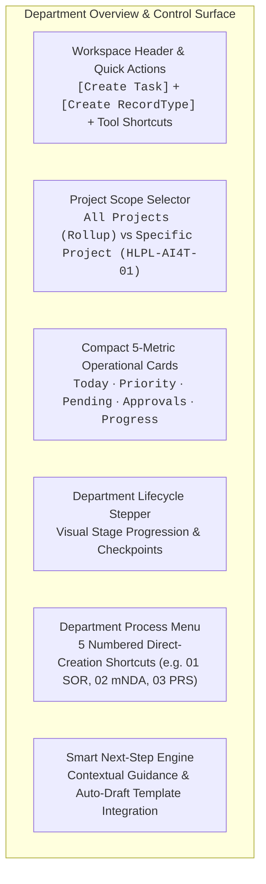
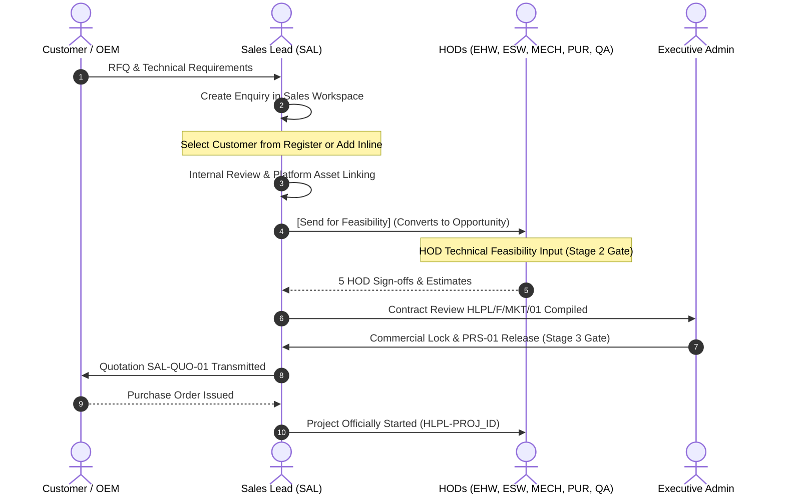

# SSM One - Web Portal Master Plan

## Plan Boundary

This document is the single, authoritative master plan for the **Hexense Labs / Six Sense Mobility Smart Company Management System (SCMS) Web Portal and its backend architecture**. It specifies the unified enterprise architecture, operational flows, data schemas, department ownership models, document controls, modular hardware reusability, and delivery roadmap.

The target is the connected Lovable project `a3399684-daab-4b38-8666-187b96b451af`, managed Supabase PostgreSQL backend, and private Cloud Storage. Web/Supabase owns identities, role permissions, operational records, official document numbering (`HLPL-[PROJ_ID]-[DEPT]-[DOC_TYPE]-[REV]`), transactions, immutable audit logs, automation triggers, and private document storage.

Evidence generated or imported for web source belongs in `docs/evidence/`. All previous redundant or fragmented plan files have been consolidated directly into this master plan to eliminate ambiguity and maintain a single source of truth.

---

## 1. Authority and How to Use This Plan

1. **Single Source of Truth**: This document supersedes all dated planning briefs, fragmented roadmap notes, and temporary plan files. If code or documentation diverges, this Master Plan governs the target architecture.
2. **Automotive & Enterprise Standards**:
   - **IATF 16949:2016** & **ISO 9001:2015**: Quality management, customer-oriented processes (COP), contract review gates, design verification (DVP&R), PPAP Level 3, and full part traceability.
   - **AIS-140 / TAC**: Telematics and emergency system certification (ARAI/ICAT).
   - **AEC-Q100 / AEC-Q200**: Automotive grade qualification for ICs and passive components.
   - **ISO 7637-2**: Electrical transient conduction along supply lines.
   - **ISO 14001:2015** & **ISO 45001:2018**: Environmental and occupational health/safety.
   - **ISO/IEC 27001:2022**: Information security management and bilateral mutual NDA controls.
3. **Core Architectural Invariants**:
   - Canonical Document ID Formula: $\text{Document ID} = \mathbf{HLPL-[\text{PROJ\_ID}]-[\text{DEPT}]-[\text{DOC\_TYPE}]-[\text{REV}]}$.
   - Master Plan §5: Decoupled Project vs. PCB vs. Wiring Harness vs. Firmware vs. Enclosure architecture with automated development process skips.
   - Symmetrical 4-group departmental Drive (`01 Common documents`, `02 Internal projects`, `03 Client projects`, `04 Other department work`).
   - Human-in-the-loop governance: Protected quality releases and commercial commitments always require recorded human sign-off.

### 1.4 Operational Enterprise Baseline & Clean UI Standard
- **Elimination of Demo/Fictional Markers**: All `"DEMO DATA ONLY"`, `"fictional"`, and `"simulated"` markers are permanently retired. The portal operates exclusively on authentic automotive master records (`Tata Motors Limited · EV Fleet Division`, `Ashok Leyland Limited`, `Select Motors Limited`, `Mahindra Electric Mobility Limited`).
- **Compact Dashboard Typography**: Dashboards adhere to high information density without vertical clutter: compact single-line headers, standard responsive grid containers, and clear inter-section spacing with dual light/dark theme support.

---

## 2. One Portal, Eleven Functional Departments

The digital backbone integrates eleven canonical automotive departments. Every employee accesses permitted work, tasks, documents, and notifications through the same unified records, filtered by department ownership.

```mermaid
graph TD
    CC["Executive Command Center<br/>Admin & HOD Overview · Daily Checklist · RACI Matrix"]
    
    subgraph Commercial & Governance ["Commercial, Quality & Governance"]
        SAL["1. SAL: Sales & Business Development<br/>CRM · Enquiries · Feasibility · Quotations"]
        QA["6. QA: Quality Assurance & APQP<br/>IATF 16949 · DVP&R · PPAP L3 · TAC Cert"]
        FIN["9. FIN: Accounts & Finance<br/>Costing · Tax Invoices · Budgets · Ledger"]
        HROPS["11. HR/OPS: HR & Operations<br/>Skill Matrix · QMS · Corporate Legal & Letterheads"]
    end

    subgraph Engineering & Design ["Product Engineering & Design"]
        EHW["2. EHW: Embedded Hardware Engineering<br/>Schematics · PCB Layout · BOM · DFMEA"]
        ESW["3. ESW: Firmware & Software Engineering<br/>RTOS Kernel · CAN J1939 · FOTA · Stack"]
        MECH["4. MECH: Mechanical Engineering<br/>IP67 Enclosures · Harness Drawings · Thermal CAD"]
    end

    subgraph Supply & Manufacturing ["Procurement, Manufacturing & Service"]
        PUR["5. PUR: Purchasing & Supply Chain<br/>Dual-Track Proto/Mass · AVL · POs · Stores"]
        EMF["7. EMF: Manufacturing & Assembly<br/>SMT Line 2 · Thermal Profiling · Control Plan"]
        TST["8. TST: Production & EOL Testing<br/>Automated Test Jigs · 100% PDI · Calibration"]
        SIT["10. SIT: Service & IT Infrastructure<br/>Cloud Drive · Telematics Server · Field RMA"]
    end

    CC --> SAL & QA & FIN & HROPS
    CC --> EHW & ESW & MECH
    CC --> PUR & EMF & TST & SIT
```



| Department Code | Full Department Title | Primary Record Type | Core Operational Ownership & Deliverables |
|---|---|---|---|
| **SAL** | Sales & Business Development | `Enquiry` | Customer Register.xlsx, RFQ intake, SOR analysis (`SAL-SOR-01`), bilateral mNDA (`SAL-mNDA-01`), contract reviews (`HLPL/F/MKT/01`), quotations (`SAL-QUO-01`), customer purchase orders (`SAL-PO-01`). |
| **EHW** | Embedded Hardware Engineering | `PRS` | System architecture, PRS (`EHW-PRS-01`), schematics (`EHW-SCH-01`), preliminary/frozen BOMs (`EHW-BOM-01`), hardware DFMEA (`EHW-DFMEA-01`), Gerber archives, AEC-Q100 compliance. |
| **ESW** | Firmware & Software Engineering | `Firmware release` | Bootloader, RTOS kernel bring-up, CAN J1939 driver, AIS-140 protocol parser, secure dual-bank FOTA, cryptographic signing, TAC compliance testing. |
| **MECH** | Mechanical Engineering | `Mechanical CAD` | 3D CAD modeling, IP67 enclosure tooling (`ENC-MECH-CAD-01`), wiring harness pinout drawings (`HARN-MECH-DWG-01`), thermal simulation, vibration fixture design. |
| **PUR** | Purchasing & SCM | `Purchase order` | Approved Vendor List (AVL), dual-track sourcing (Proto soft-tooling vs Mass production), PR/RFQ/PO issuance, supplier PPAP Level 3 review, stock allocation. |
| **QA** | Quality Assurance & APQP | `Quality inspection` | APQP roadmap (`HLPL-APQP-001`), DVP&R matrix (`QA-DVP-01`, 18 electrical/environmental tests), ISO 7637-2 compliance, Type Approval TAC cert (`QA-TAC-01`), NCR/CAPA logs. |
| **EMF** | Manufacturing & Assembly | `Work instruction` | 10-zone reflow thermal profiling, 3D solder paste inspection (SPI), automated optical inspection (AOI), Process Control Plan (`EMF-CP-01`), SMT work instructions. |
| **TST** | Production & EOL Testing Jigs | `Calibration log` | Automated functional testing (FCT) jigs, CAN bus verification, flashing rigs, 100% PDI inspection certification (`TST-PDI-01`), calibration logs. |
| **FIN** | Accounts & Finance | `Commercial quotation` | Project budget tracking, commercial margin analysis, milestone billing, GST/HSN tax invoices (`FIN-INV-01`), payment reconciliation. |
| **SIT** | Service & IT Infrastructure | `Service ticket` | Enterprise Cloud Drive storage, telematics backend gateway, OTA server monitoring, role-based access control, field service ticketing. |
| **HR/OPS** | HR & Operations | `Audit report` | Employee competence matrix (`HLPL/F/HR/03`), QMS internal audits, Six Sigma DMAIC registers, Signed-In Company Directory, Corporate Legal Documents & Letterheads. |

---

## 3. Command Center, Personas & Role-Switching Governance

### 3.1 Role & Persona Switcher
The portal incorporates an instant **Role & Persona Switcher** in the header allowing 1-click verification of department context, permission boundaries, and filtered queues:
1. **Executive Admin / MD**: Master authority, full cross-department rollup, system template configuration, and PMSS override.
2. **11 Department Leads**:
   - `SAL Lead`: Priya Sharma (Sales & BD)
   - `EHW Lead`: Avery Vale (Embedded Hardware)
   - `ESW Lead`: Devon Lane (Firmware & Software)
   - `MECH Lead`: Samira Holt (Mechanical Engineering)
   - `PUR Lead`: Morgan Reed (Purchasing & SCM)
   - `QA Lead`: Jordan Blake (Quality Assurance)
   - `EMF Lead`: Casey Rowan (Electronics Manufacturing)
   - `TST Lead`: Mina Cross (EOL Testing & Jigs)
   - `FIN Lead`: Priya Voss (Finance & Accounts)
   - `SIT Lead`: Kai Morgan (Service & IT Infrastructure)
   - `HR Lead`: Taylor Quinn (HR & Operations)
3. **Client Portal Persona**: Rohan Verma (Tata Motors Fleet Manager) — restricted customer view displaying order tracking, published TAC certificates, and customer ticket status.

When switched, the portal displays a persistent active persona banner with a 1-click `[Switch Back to Admin]` button. Every persona change is audited in the immutable event log.

### 3.2 Executive Command Center Overview
The **Home / Command Center** serves as the compact operational hub:
- **Header Action Bar**: Unified `[Create Task]`, `[Cross-Department Sync]`, `[Auto-Draft Templates]`, and `[Platform Asset Library]` actions.
- **Executive KPI Cards**: 6 responsive compact metrics tracking Active Project, Order Volume, Revenue, Stage, Audit Score, and System Sync.
- **Nine-Stage Project Stepper**: Real-time project milestone tracking with 1-click stage inspection.
- **Two-Column Daily Task Checklist**:
  - Left Lane: *Today's Action Items* with quick complete and status toggles.
  - Right Lane: *Pending & Overdue Tasks* with priority indicators (Critical, High, Normal, Low) and assignee badges.
- **Department Quick Management Grid**: Cards for all 11 departments showing active lead, open task count, pending approvals, and direct deep-link into the department workspace.

---

## 4. Universal Departmental Overview & Dynamic Record Creation

The overview section is the operational heart of each workspace. It unites real-time department metrics, project scoping, lifecycle flow visualization, and direct dual-action record creation.



### 4.1 Compact Metric Cards Design System
Every department overview features five standardized, high-density KPI cards engineered for immediate situational awareness:
1. **Today**: Tasks due today or reviews scheduled for today (`fields["dueDate"] === today`).
2. **Priority**: High-risk items requiring urgent action (`priority === "High" || priority === "Critical"`).
3. **Pending**: Unreleased records (`status === "Draft" || status === "Open"`).
4. **Approvals**: Formal sign-offs awaiting human review (IATF 16949 / ISO 9001 governance).
5. **Progress**: Overall completion rate (% of department deliverables marked `Approved` or `Released`).

#### Card Density & Visual Rules
- **Padding**: Dense vertical padding (`p-2.5 sm:p-3`) to maximize vertical space on standard laptop screens (`1366x768` to `1920x1080`).
- **Typography Scale**: Compact numeric display (`text-xl font-bold sm:text-2xl`), single-line uppercase category eyebrow (`text-[10px] font-semibold uppercase tracking-[.1em] text-muted-foreground`), and concise status subtitle (`text-[11px] text-muted-foreground truncate mt-0.5`).
- **Status Indicator**: Minimal color-coded status dot (`size-2 rounded-full`) indicating operational health (`danger`, `steel`, `moss`, `warning`).
- **Grid Layout**: Responsive 5-column grid (`grid gap-2.5 sm:grid-cols-2 xl:grid-cols-5`) ensuring balanced horizontal layout without vertical stacking.

### 4.2 Dual-Action Record Creation Pattern
The workspace header provides two complementary, instant creation mechanisms:
1. **Universal Tracked Task (`[Create Task]`)**:
   - Present across all 11 departments.
   - Auto-generates department-scoped task identifier: `TASK-[DEPT]-[NUM]` (e.g. `TASK-SAL-004`, `TASK-EHW-012`).
   - Automatically synchronizes with the Daily Checklist, Today lane, and Priority queues.
2. **Primary Domain Record (`[Create <RecordType>]`)**:
   - Primary accent button dynamically configured to the department's core deliverable:
     - Sales: `[Create Enquiry]`
     - Hardware: `[Create PRS]`
     - Firmware: `[Create Firmware release]`
     - Mechanical: `[Create Mechanical CAD]`
     - Purchasing: `[Create Purchase order]`
     - Quality: `[Create Quality inspection]`
     - Manufacturing: `[Create Work instruction]`
     - EOL Testing: `[Create Calibration log]`
     - Finance: `[Create Commercial quotation]`
     - Service & IT: `[Create Service ticket]`
     - HR & Ops: `[Create Audit report]`
   - Generates official document numbering: `HLPL-[PROJ_ID]-[DEPT]-[DOC_TYPE]-[REV]`.

### 4.3 Department Process Menus (Numbered Shortcuts)
Directly beneath the lifecycle stepper, each department workspace embeds a **Department Process Menu** featuring 5 numbered, direct-creation shortcuts that immediately initialize pre-configured engineering forms and assign the appropriate Cloud Drive folder:

| Dept | Process 01 | Process 02 | Process 03 | Process 04 | Process 05 | Cloud Drive Folder |
|---|---|---|---|---|---|---|
| **SAL** | Customer enquiry & lead intake | Customer SOR intake & analysis | Mutual NDA generator | Commercial quotation builder | Contract review record | `/01_Governance_and_QMS` |
| **EHW** | System architecture & PRS builder | Schematic capture & design freeze | Preliminary & production BOM | Hardware DFMEA risk assessment | Gerber & fabrication release | `/02_Hardware_Engineering` |
| **ESW** | MCU board support package (BSP) | CAN J1939 telemetry stack | AIS-140 emergency protocol parser | Secure dual-bank FOTA setup | Production binary signing | `/03_Firmware_and_Software` |
| **MECH** | IP67 enclosure 3D CAD modeling | Wiring harness drawing & pinout | Thermal dissipation simulation | Injection mold DFM review | Ingress & vibration fixture | `/04_Mechanical_Engineering` |
| **PUR** | Sourcing PR & RFQ issuance | Proto vs Mass vendor evaluation | Commercial purchase order (PO) | Incoming quality check (IQC) | Approved Vendor List (AVL) update | `/05_Purchasing_and_SCM` |
| **QA** | APQP gate milestone review | DVP&R test plan configuration | ISO 7637-2 electrical transient | Type Approval TAC coordination | Non-conformance & CAPA report | `/06_Quality_Assurance` |
| **EMF** | SMT Line 2 thermal profiling | 3D SPI & AOI inspection setup | Process Control Plan (CP) | PCB assembly traveler creation | Final potting & box-build WI | `/07_Electronics_Manufacturing` |
| **TST** | Automated EOL test jig setup | CAN bus functional test suite | Automated MCU firmware flashing | 100% PDI inspection cert | Test jig sensor calibration | `/08_EOL_Testing_Jigs` |
| **FIN** | Project NRE & BOM cost model | Customer advance deposit match | GST commercial tax invoice | Supplier PO payment release | Financial margin & audit review | `/09_Finance_and_Accounts` |
| **SIT** | Symmetrical Cloud Drive sync | Telematics server endpoint config | Private S3 signed storage token | User RBAC permission audit | Field RMA & service ticket | `/10_Service_and_IT` |
| **HR/OPS**| Employee skill matrix review | IATF 16949 internal audit | Corporate legal agreement / mNDA | Official letterhead generator | Six Sigma DMAIC improvement | `/11_HR_and_Operations` |

### 4.4 Project Scope Filtering
Every department workspace includes an interactive **Project Scope Selector**:
- **All Projects (Department Rollup)**: Displays department-wide aggregated metrics, all open tasks across projects, team capacity, and overall workload.
- **Specific Project Scope** (e.g. `HLPL-AI4T-01 · Tata Ace EV` or `HLPL-SLCT-01 · AIS-140 Gateway`):
  - Filters the entire workspace to show only records, checklist tasks, deliverables, team members, and stage evidence linked to that selected project.

### 4.5 Purchasing Context (PUR): Complete Purchasing Command Center & Mutual Linkage
The Purchasing workspace is implemented as a comprehensive four-module command center (`PurchasingCommandCenter.tsx`) that unifies commercial vendor pricing, purchase order volume commitments, governed inventory stores, and approved supplier governance:

1. **Tab 1: Recordage & Stores**:
   - Integrates the full `LiveInventoryWorkspace` with PUR column presets, Inward GRN receipt processing, IQC hold availability gating, lot tracking, stock movement history, and serialized asset compatibility.
   - Embeds Mouser Search API v1 Key configuration (`localStorage["scms_mouser_api_key"]`) allowing 1-click live REST API lookups or offline verified automotive master catalog lookups.
2. **Tab 2: Quotations & Vendor Pricing Breaks**:
   - Manages commercial vendor quotations with tiered volume price breaks (1,000 pcs proto baseline, 10,000 pcs ramp-up, and 50,000 pcs mass production).
   - Tracks quoted factory lead times, warranty standards (e.g. 24–36 months), and commercial validity expiry dates.
   - Provides 1-click `[Convert to PO]` which auto-locks the target part MPN, supplier, unit price, and inherited warranty terms into an official Purchase Order.
   - Embeds the `PurchasingBOMReviewTable` for direct engineering vs procurement line-by-line comparison and release to manufacturing.
3. **Tab 3: Purchase Orders (POs) Alignment with 50,000 Annual Sales Target**:
   - Tracks estimated component purchase quantities vs. the 50,000 annual vehicle sales target for project `HLPL-AI4T-01` (Tata Ace EV 4G Gateway) with visual progress coverage bars.
   - Tracks batch delivery schedules (e.g. Batch 1: 5,000 pcs, Batch 2: 10,000 pcs), unit costs in USD ($) and INR (₹), and committed total order values.
   - Inherits warranty coverage and accreditation validity directly from the approved vendor.
   - Features 1-click `[📦 Receive GRN]` on issued POs that routes directly into Recordage & Stores for official inward receipt and IQC inspection.
4. **Tab 4: Supplier Management (Approved Supplier List / ASL / ACML)**:
   - Tracks Tier-1 automotive franchise suppliers (Mouser, Arrow, Quectel, Texas Instruments, Molex) with full vendor profiles and contacts.
   - **Supplier Warranty Terms**: Explicit warranty period (months), RMA turnaround time (TAT SLA, e.g. 5–7 business days), and coverage scope (100% replacement for electrical parametric failure, reel defects, or moisture damage).
   - **Supplier Validity & Accreditations**: Tracks IATF 16949:2016 expiry dates, ISO 9001:2015 expiry dates, VDA 6.3 process audit scores (e.g. Grade A 96%), and upcoming on-site audit due dates.
   - **Supplier Documentation & Dossier**: Direct tracking of PPAP Level 3 dossiers, bilateral mutual NDAs, GST tax registrations, ISO/AS9120 certificates, and RoHS/REACH compliance declarations.
   - Includes interactive **Supplier Dossier Modals** with verified download badges and 1-click `[+ Raise PO]` generation.
5. **Department-Specific Sidebar Navigation**:
   - When the sidebar is expanded (`w-64`), the `PUR` navigation rail renders four dedicated 1-click sub-options (`Recordage`, `Quotations`, `Purchase Orders`, `Suppliers (ASL)`), providing instant department-level navigation with active state highlighting. Supported identically in both desktop sidebar and mobile menu.

### 4.6 Quality Assurance Context (QA): Hardware DVP&R Plan & Lab Certification Matrix
The Quality Assurance workspace incorporates an interactive compliance verification matrix (`QualityAssuranceDVPReviewTable`) operating under IATF 16949 §8.3.4.4 and AIS-140 APQP:
- **10 Core Automotive Test Regimes**: Tracks electrical transients (ISO 7637-2), load dump clamping (ISO 16750-2 Pulse 5b), reverse polarity/jump-start, radiated/conducted emissions (CISPR 25 Class 3), electrostatic discharge (ISO 10605), thermal shock (ISO 16750-4), water/dust ingress (ISO 20653 IP67), road vibration (AIS-140 Annex 8), emergency packet protocol (AIS-140 Annex 3), and HTOL 500-hour endurance.
- **Dual Lab Facility Routing**:
  - **Internal Lab**: Hexense In-House Chambers & R&D Benches (transient pulse generator, ESD gun, dual-chamber thermal oven, burn-in rack).
  - **Outsourced Accredited Lab**: NABL / Type Approval facilities (ARAI Pune, ICAT Manesar, TUV Rheinland) for statutory AIS-140 TAC certifications.
- **Zero-Deviation Traceability**: Tracks Sample Size (DUT count), Target Completion Dates, Test Report Numbers (`HLPL-DVP-TR-01` to `10`), with actions to *Execute Internal Test*, *Attach Lab Certificate*, and *Issue Zero-Deviation Release*.

---

## 5. One Sales Flow: Enquiries, Opportunities & Feasibility Gate

The commercial workflow follows a single, unified queue without competing entry points:



### Flow Steps & Persisted Results
1. **New Enquiry**: Select existing customer or use inline *Add Customer* modal; capture requirement and technical scope. Generates server-numbered enquiry (`ENQ-2026-XXX`).
2. **Internal Review**: Assign Sales owner, set target closure date, and attach preliminary files.
3. **Platform Asset Linking & Feasibility Dispatch**:
   - Primary action: `[Send for Feasibility]`.
   - Embeds the **Platform Architecture Selector**: chooses Reusable Platform vs. Hybrid vs. Clean Sheet.
   - Links pre-qualified Motherboard, Secondary PCB, Harness, Firmware, and Enclosure assets.
   - Calculates development skips (weeks saved and NRE avoided).
   - Dispatches review tasks to the 5 engineering HODs (EHW, ESW, MECH, PUR, QA).
4. **Multi-Department Feasibility Input (Gate 2)**:
   - Each HOD reviews their technical domain, confirms lead times, flags risks, and records formal sign-off.
   - Locking all 5 HOD sign-offs compiles the official **Contract Review Record (`HLPL/F/MKT/01`)**.
5. **Requirement & Commercial Lock (Gate 3)**:
   - Auto-generates frozen Product Requirement Specification (`HLPL-[PROJ_ID]-EHW-PRS-01`) and Commercial Quotation (`HLPL-[PROJ_ID]-SAL-QUO-01`).
6. **Project Kick-off**: Formal conversion creates the project workspace, pins master references, and authorises the hardware kickoff track.

---

## 6. Decoupled Architecture: Project vs. PCB vs. Harness vs. Firmware vs. Enclosure

### 6.1 The Automotive Decoupling Principle
A **Project is a Customer Commercial Commitment**, not a single physical hardware file. In automotive electronics:
- **A Project can incorporate multiple PCBs**: A telematics terminal frequently pairs a Core Motherboard (`HLPL-MOD-PCB-01`) with a Dual-CAN Daughterboard (`HLPL-MOD-PCB-02`) or a 9–100V EV SMPS Board (`HLPL-PWR-SMPS-01`).
- **Wiring Harnesses are Interchangeable**: The same physical PCB unit can connect to a commercial fleet via an OBD-II pass-through harness (`HLPL-HARN-OBD2-16P`), to an EV bus via a sealed Molex MX150 harness (`HLPL-HARN-MX150-14P`), or to an industrial tractor via a Deutsch DT04 connector (`HLPL-HARN-DT04-12P`).
- **Firmware & Enclosures are Reusable Modular Assets**: Proven, certified software stacks (e.g. ARAI/ICAT certified AIS-140 RTOS v2.4.1) and IP67 molded enclosures are reused across multiple OEM clients with zero re-certification overhead.

```mermaid
graph TD
    subgraph Master Catalog ["Authoritative Master Asset Libraries (EHW / ESW / MECH)"]
        PCB1["Master Motherboard<br/><code>HLPL-MOD-PCB-01 Rev 03</code>"]
        PCB2["Master Dual-CAN Board<br/><code>HLPL-MOD-PCB-02 Rev 01</code>"]
        HARN1["Molex MX150 14-Pin<br/><code>HLPL-HARN-MX150-14P</code>"]
        HARN2["OBD-II Pass-through<br/><code>HLPL-HARN-OBD2-16P</code>"]
        HARN3["Deutsch DT04 12-Pin<br/><code>HLPL-HARN-DT04-12P</code>"]
        FW1["AIS-140 RTOS Stack<br/><code>HLPL-FW-AIS140-RTOS v2.4.1</code>"]
        ENC1["IP67 Polycarbonate Case<br/><code>HLPL-ENC-IP67-PC</code>"]
    end

    subgraph ClientA ["Project: Tata Ace EV (HLPL-AI4T-01)"]
        direction TB
        CA_PCB["Motherboard: PCB-01"]
        CA_HARN["Harness: Molex MX150 (Sealed)"]
        CA_FW["FW: AIS140 RTOS (AIS-140)"]
        CA_ENC["Case: IP67 PC"]
    end

    subgraph ClientB ["Project: Select Motors (HLPL-SLCT-01)"]
        direction TB
        CB_PCB["Same Motherboard: PCB-01"]
        CB_HARN["Different Harness: OBD-II Y-Cable"]
        CB_FW["Same FW: AIS140 RTOS"]
        CB_ENC["Same Case: IP67 PC"]
    end

    subgraph ClientC ["Project: Heavy CV Dual-CAN (HLPL-XLINK-03)"]
        direction TB
        CC_PCB1["Motherboard: PCB-01"]
        CC_PCB2["Daughterboard: PCB-02"]
        CC_HARN["Heavy Harness: Deutsch DT04"]
        CC_FW["FW: Dual-CAN RTOS"]
        CC_ENC["Case: Extruded Aluminum"]
    end

    PCB1 -.-> CA_PCB & CB_PCB & CC_PCB1
    PCB2 -.-> CC_PCB2
    HARN1 -.-> CA_HARN
    HARN2 -.-> CB_HARN
    HARN3 -.-> CC_HARN
    FW1 -.-> CA_FW & CB_FW
    ENC1 -.-> CA_ENC & CB_ENC
```



### 6.2 Reference & Re-Branding Model
- **Master Files Remain Authoritative**: Master schematics, layouts, firmware repositories, and mold drawings remain stored and maintained under their master IDs (`HLPL-MOD-PCB-01`, `HLPL-HARN-MX150-14P`).
- **Project Deliverables Use Branded Identifiers**: Project documentation (PRS, BOM, SCH, GERBER) generates unique project-branded identifiers:
  $$\text{Deliverable ID} = \mathbf{HLPL-[\text{PROJ\_ID}]-[\text{DEPT}]-[\text{DOC\_TYPE}]-[\text{REV}]}$$
  Example: Tata Ace EV BOM is `HLPL-AI4T-EHW-BOM-01`, which references Master Motherboard `HLPL-MOD-PCB-01 Rev 03`. This avoids duplicate CAD drawings while preserving formal IATF 16949 audit lineage.

### 6.3 Automated Development Process Skip Engine
When a project links pre-qualified platform assets at intake/feasibility, the system calculates exact time and cost savings:

| Platform Component Reused | Development Stage Waived | Time Saved | NRE Expense Avoided |
|---|---|---|---|
| **Core Motherboard PCB** | Architecture freeze, schematic capture, PCB layout, prototype fabrication | **8 – 12 Weeks** | **₹3,00,000 – ₹4,50,000** |
| **Secondary Daughterboard** | Interface circuit design, bus layout, prototyping | **3 – 4 Weeks** | **₹1,00,000 – ₹1,50,000** |
| **Wiring Harness** | Automotive harness tooling, sample build, sealing validation | **2 – 3 Weeks** | **₹50,000 – ₹1,00,000** |
| **Firmware Stack** | RTOS kernel bring-up, protocol stack coding, TAC pre-testing | **4 – 6 Weeks** | **₹1,50,000 – ₹2,50,000** |
| **Enclosure Molds** | Injection mold tooling, DFM review, ingress sealing trials | **3 – 4 Weeks** | **₹2,00,000 – ₹3,50,000** |
| **TOTAL (Full Platform Reuse)** | **Stage 4 PoC Bench Bring-Up WAIVED** | **14 – 17 Weeks** | **Up to 95% NRE Avoided** |

### 6.4 Stage 4 PoC Waiver Mechanism
In Gate 4/5 (Hardware Kick-off):
- If `canSkipStage4PoC === true` (PCB and Firmware are pre-certified under AEC-Q100 / AIS-140):
  - The system displays the **⚡ Pre-Certified Platform Architecture Detected** banner.
  - Option A (*Clean Sheet / PoC Research*) is marked optional.
  - Option B (*Direct SMT Pilot Build*) is automatically **RECOMMENDED (PLATFORM REUSED)**.
  - Advancing hardware kickoff jumps directly to **Stage 5 (SMT Pilot Build)**, waiving 14–17 weeks of redundant bench development.

### 6.5 Automated Stage Gate Dependency & Manufacturing Interlock Rules
To guarantee automotive product integrity under IATF 16949 §8.3 and prevent premature manufacturing investment:
- **Hardware Schematics Critical Path Interlock**:
  $$\text{Stage 5 (SMT Pilot)} \lor \text{Stage 7 (Mass Production)} \implies \text{Status}(\text{EHW-SCH-01}) == \text{Released}$$
  - **Rule**: Neither manufacturing tooling (SMT Line 2 reflow profiling) nor Pilot/Mass production may proceed until **Stage 4 Hardware Schematics (`EHW-SCH-01`)** has been officially certified and released by Embedded Hardware.
  - **Enforcement Engine**: The system programmatically locks downstream stages, displaying an explicit interlock banner:
    > *"Interlock Enforced: Stage 4 Hardware Schematics (EHW-SCH-01) must be released and signed off by Embedded Hardware before SMT Line 2 tooling and Pilot assembly can commence."*
- **Client-Facing Stage Dependency Matrix**: Surfaced in the Client Portal view (`?role=client`), showing Stage ID, Stage Name, Mandatory Prerequisites, Dependency Status, and Production Interlock state.

---

## 7. Symmetrical Departmental Drive & Work Registers

Every department workspace features a symmetrical **4-group cloud drive architecture**:

```text
[Department Workspace]
├── 01 Common documents       (SOPs, QMS procedures, authority matrix, templates)
├── 02 Internal projects      (Internal R&D, test jigs, platform development)
├── 03 Client projects        (Customer projects: HLPL-AI4T-01, HLPL-SLCT-01)
└── 04 Other department work  (Audit records, calibration certs, supplier PPAPs)
```

### Key Work Registers
1. **Customer Register.xlsx** (`01_Governance_and_QMS`):
   - Managed live spreadsheet in Sales workspace containing all customer accounts, GSTIN, SPOCs, active programs, and credit limits.
   - Synchronized with customer records without requiring external workbook uploads.
   - 1-click modal view and native `.xlsx` download.
2. **Project Master Spec Sheet (PMSS)**:
   - Central engineering register maintaining volume commitments, hardware configurations, BOM baselines, and firmware versions for all active projects.
3. **Signed-In Company Directory** (§11):
   - Real-time staff directory accessible from the header and PMSS with department filters, extensions, email, and skill matrix summaries.
4. **Official Project Decision Log** (§11):
   - Immutable audit register capturing technical/commercial decisions, author, rationale, alternatives considered, affected departments, and status (Proposed, Locked, Executed, Superseded).
5. **Operations Legal Documents & Corporate Letterhead Hub** (§11):
   - Houses formal bilateral mutual NDAs (`HLPL-AI4T-OPS-mNDA-01`), vendor agreements, and a corporate letterhead generator with customizable company addresses, logos, and IATF/ISO accreditations.

### 7.4 Department-Scoped Document Access (RBAC) & Client Sanitization
To preserve department accountability and intellectual property protection:
- **Prepared / Reviewed / Controlled By Rule**: Users logged into a department role only see documents that are:
  1. Authored/owned by their department (`doc.department === activeRole`).
  2. Routed to their department for review or approval.
  3. Controlled by corporate QMS (common policy SOPs).
- **Client Portal Sanitization Protocol**: When accessed via `?role=client`, internal design failure modes (DFMEA), confidential supplier margins, and non-client risk assessments are automatically redacted, presenting only client-authorized commercial deliverables (Customer SOR, Quotation, TAC Certificate, Tax Invoice, PDI release).

### 7.5 Governed Inventory & Asset Workspace Architecture
Extends the governed inventory experience into an enterprise inventory-and-assets workspace while preserving stock, receiving, project-link, audit, and authorization controls.

#### Architectural Principles & Boundaries
1. **Wire Harnesses as Assemblies**: Wire harnesses (`HLPL-HARN-...`) are modeled as project-linked connector-and-wire assemblies, not raw material hardness. They carry wire specifications (FLRY-B thin-wall ISO 6722, TXL cross-linked SAE J1128), connector pins, approved substitutes, and assembly crimp tooling links.
2. **Dual-Discovery Classification**: Harnesses possess one controlled primary category (`Wire Harnesses`) plus `Mechanical` and `Electrical` cross-tags for multi-department discovery.
3. **Asset Decoupling**: Production machinery (`Yamaha YS12 SMT`), mechanical equipment (`Komax Gamma 255 Wire Crimper`, `Branson 2000X Ultrasonic Welder`), testing fixtures (`Automated EOL Rig`), and compliance test rigs (`EM Test UCS 500N`) live in a dedicated serialized register with calibration intervals, custodians, and compatible-part links, completely separated from stock-part inventory.
4. **Server-Side Project Team Recipient Scope Validation**: A component or harness can be issued only to an active member of its linked project team (`projectTeamRoster[projectCode]`), rejecting cross-project, inactive, or department-ineligible personnel.
5. **Quality-Held Lot Stock Rule**: Any stock received under "Pending IQC" or placed in quarantine is placed in `held` stock and programmatically blocked from issuance:
   $$\text{Available Stock} = \max\left(0, (\text{Released} \text{ or } \text{OnHand}) - \text{Held} - \text{Allocated}\right)$$

#### The Six Governed Workspace Tabs
- **Tab 1: Component & Parts Register**: Multi-level hierarchy (Electronics, Connectors, Wire and Cable, Wire Harnesses, Mechanical, Enclosures, Firmware Tools, Production Tools, Packaging & Consumables). Multi-dimensional filtering by category, cross-tags, location, and project link.
- **Tab 2: Wire Harness Assemblies**: Automotive connector-and-wire assemblies with terminal pinouts, wire gauges, pull-force ratings, approved alternates, and compatible fabrication assets.
- **Tab 3: Project Material Issuance & Returns**: Controlled issuance with project-team validation, request keys, and return dialog with Usable vs. Quarantine disposition.
- **Tab 4: Goods Received Notes (GRN) & IQC Traceability**: PO-led receiving with supplier, invoice, lot/batch/date code, location/bin, and accepted vs. quality-held split.
- **Tab 5: Governed Asset Register**: Serialized assets, custody tracking, calibration scheduling, and bidirectional machine-to-part compatibility relations.
- **Tab 6: Stock Movement & Audit Log**: Immutable audit trail with timestamps, actors, transaction keys, and movement reasons.

---

## 8. Controlled Document Engine & Native Print/PDF Output

### 8.1 Automatic Document Numbering Formula
All documents generated across the enterprise strictly follow:
$$\mathbf{HLPL-[\text{PROJ\_ID}]-[\text{DEPT}]-[\text{DOC\_TYPE}]-[\text{REV}]}$$
Forms use the canonical quality record standard: `HLPL/F/[DEPT]/[NUM]` (e.g. `HLPL/F/MKT/01`, `HLPL/F/HR/03`).

### 8.2 Full Multi-Section Document Content
Auto-drafted templates render complete, authentic engineering sheets (not metadata summaries):
- **Document Control Header Table**: Company Logo, Name, Address, Document Title, Document Number, Revision, Effective Date, Page Number.
- **Section 1.0**: Scope, Standards & Traceability Matrix (IATF 16949 §8.2, AIS-140, AEC-Q100).
- **Section 2.0**: System Architecture, Block Diagram & Interfaces.
- **Section 3.0**: Detailed Technical Specifications (Microcontroller, Modem, Power Supply, CAN bus).
- **Section 4.0**: Bill of Materials / Process Control Plan / DVP&R Matrix Table.
- **Section 5.0**: Multi-HOD RACI Sign-off Matrix with Department Lead signatures.
- **Document Footer**: Confidentiality clause, ISO 9001:2015 & IATF 16949 compliance notice, dynamic page count.

### 8.3 Isolated A4 Iframe Print & PDF Export
- Document printing uses an isolated DOM iframe passing pure document HTML and print styles.
- `@media print` rules enforce standard A4 dimensions (`210mm x 297mm`), `margin: 10mm`, and `print-color-adjust: exact`.
- Completely prevents dark-theme inversion, modal dialog overflow cutoffs, or trailing blank pages.

---

## 9. Dynamic RACI Matrix & Inter-Department Stage Notifications

### 9.1 RACI Configuration
The portal administration panel features an interactive **RACI Responsibility Matrix** defining department roles across all 9 lifecycle stages:
- **R (Responsible)**: Department executing the primary deliverable.
- **A (Accountable)**: Final gatekeeper and sign-off authority.
- **C (Consulted)**: Functional contributors providing feasibility and design input.
- **I (Informed)**: Downstream departments receiving automated handoff notifications.

### 9.2 Automated Stage Handoff Routing
When any department completes a gate or signs a deliverable:
1. The system evaluates the active RACI matrix for the current stage.
2. Generates actionable alert records for all *Responsible*, *Accountable*, and *Informed* departments.
3. Notification bell updates with badge count; alert cards display 1-click `[Review Handoff]` actions linking directly to the pending document.

---

## 10. End-to-End Project Lifecycle Walkthrough (`HLPL-AI4T-01`)

The portal incorporates a complete, interactive simulation of the **Tata Ace EV 4G AIS-140 Telematics Gateway** (50,000 units / ₹20.33 Cr) covering all 9 automotive stages:

| Stage | Name & Intent | Primary Controlled Deliverable | Owning Dept |
|---|---|---|---|
| **Stage 1** | Client & Sales Intake | Customer SOR (`HLPL-AI4T-SAL-SOR-01`) & mNDA (`SAL-mNDA-01`) | `SAL` |
| **Stage 2** | Multi-Dept Feasibility Gate | Contract Review Record (`HLPL/F/MKT/01`) with 5 HOD sign-offs | `SAL` / All |
| **Stage 3** | Requirement Freeze & Commercial Lock | Product Requirement Spec (`EHW-PRS-01`) & Quotation (`SAL-QUO-01`) | `EHW` / `SAL` |
| **Stage 4** | Design & Development (PoC) | Schematics (`EHW-SCH-01`), Preliminary BOM (`EHW-BOM-01`), PoC FW | `EHW` / `ESW` |
| **Stage 5** | Pilot Build & SMT Setup | Process Control Plan (`EMF-CP-01`), SMT Line 2 Thermal Profile | `EMF` / `PUR` |
| **Stage 6** | DVP&R Pre-Compliance | DVP&R Matrix (`QA-DVP-01`) with 18 electrical/environmental tests | `QA` |
| **Stage 7** | Production Release & PPAP L3 | Gerber Rev B, Hardware DFMEA (`EHW-DFMEA-01`), Supplier PPAP | `EHW` / `PUR` |
| **Stage 8** | TAC Type Approval & Mass Run | AIS-140 TAC Certificate (`QA-TAC-01`), PO Sync (`SAL-PO-01`) | `QA` / `SAL` |
| **Stage 9** | PDI Inspection & Invoicing | Automated EOL PDI Certificate (`TST-PDI-01`), Commercial Invoice (`FIN-INV-01`) | `TST` / `FIN` |

### Master Document Dossier Binder
A unified modal tab allows viewing and downloading all 12 automotive deliverables in a single binder, complete with live stage progression percentage and audit history.

---

## 11. Signed-In Company Directory, Decision Log & Corporate Legal Hub

### 11.1 Signed-In Company Directory (§11.1)
- Real-time directory modal accessible from the portal navigation.
- Department filter chips (`ALL`, `SAL`, `EHW`, `ESW`, `MECH`, `PUR`, `QA`, `EMF`, `TST`, `FIN`, `SIT`, `HR/OPS`).
- Search by employee name, role title, or key technical competency.
- Individual staff cards show photo, official designation, direct phone extension, email, and competency skill tags derived from Skill Matrix `HLPL/F/HR/03`.

### 11.2 Official Project Decision Log (§11.2)
- Formal engineering and commercial governance register.
- Captures decision title, date/timestamp, authorizing stakeholder, detailed engineering rationale, alternatives evaluated, and list of affected departments.
- Status states: `Proposed`, `Locked`, `Executed`, `Superseded`.
- Directly linked to the Project Master Spec Sheet (PMSS).

### 11.3 Operations Legal Documents & Corporate Letterhead Hub (§11.3)
- Multi-tab legal portal managing:
  - Bilateral mutual NDAs (`HLPL-AI4T-OPS-mNDA-01`) with confidentiality terms and authorized signatures.
  - Corporate Letterhead Generator rendering official corporate communications with configurable company logos, registration numbers, ISO/IATF accreditation badges, and legal footers.

---

## 12. Completed Milestones & Remaining Delivery Roadmap

### Completed Milestones
- [x] **11 Functional Departments**: Symmetrical hubs for SAL, EHW, ESW, MECH, PUR, QA, EMF, TST, FIN, SIT, and HR/OPS.
- [x] **Universal Department Overview**: Compact 5-metric cards (`Today`, `Priority`, `Pending`, `Approvals`, `Progress`), dual creation action bar (`[Create Task]` + `[Create <RecordType>]`), project scope filter, and 5 numbered process menu shortcuts.
- [x] **Admin Persona & Role Switcher**: Instant switching between Executive Admin, 11 HODs, and Client Portal persona.
- [x] **AI4T 9-Stage Lifecycle Simulator**: Complete 9-stage progression with 12-document master dossier.
- [x] **Decoupled Architecture & PCB Reusability (Master Plan §5)**: Multi-PCB linking, modular harnesses, firmware stacks, and enclosures.
- [x] **Development Process Skip Engine**: Time/cost calculations with automated Stage 4 PoC waiver.
- [x] **Document Control Numbering**: Automated `HLPL-[PROJ_ID]-[DEPT]-[DOC_TYPE]-[REV]` formula.
- [x] **Full-Page Document Preview & PDF Engine**: Isolated A4 iframe print without overflow or dark mode artifacts.
- [x] **Configurable Corporate Template Settings**: Customizable company headers, footers, logos, and accreditations.
- [x] **Dynamic RACI Matrix & Stage Handoff Alerts**: Configurable RACI table with automated notification routing.
- [x] **Signed-In Company Directory (§11)**: Real-time staff contact directory with department filtering.
- [x] **Official Project Decision Log (§11)**: Immutable technical and commercial decision tracking.
- [x] **Operations Legal & Letterhead Hub (§11)**: Corporate mNDA and branded letterhead generation.
- [x] **Customer Register.xlsx**: Managed live customer sheet with native download.
- [x] **Dual Project Scope in Departments**: Filter views by All Projects (Rollup) vs. Specific Project.
- [x] **Phase 1: Symmetrical Cloud Drive & File Manager (§7)**:
  - 4-Group symmetrical drive architecture (`01 Common documents`, `02 Internal projects`, `03 Client projects`, `04 Other department work`).
  - Direct file upload dropzone supporting PDF, DOCX, XLSX, STEP, ZIP, HEX with progress bar and SHA-256 verification.
  - S3 / Lovable Cloud Storage private access indicator, download buttons, and revision tracking.
- [x] **Phase 2: Department-Wise Process Menus & Action Shortcuts (§4, §12)**:
  - Structured 5 numbered process shortcuts for all 11 departments (55 total processes) in `departmentProcesses`.
  - Clicking any process shortcut immediately opens `RecordForm` pre-filled with the exact canonical record type, specific title, pre-filled scope linking to the target Cloud Drive folder, project ID, location, and priority.
- [x] **Clean Compilation & Automated Tests**: 0 TypeScript errors (`npx tsc --noEmit`), production build passing, Playwright regression suite passing with 100% success across all phases.

- [x] **Phase 3: Supabase Shared Persistence Migration**:
  - Dual-track persistence architecture pairing high-speed offline browser-local storage with Lovable Cloud Supabase Postgres (`rzskhndweihuczbdhoxk.supabase.co`).
  - Interactive Cloud & Supabase Sync panel in Administration command center with real-time cluster health pinging, latency diagnostics, telemetry counters, offline JSON snapshot backups, and cloud synchronization controls.
  - Fully verified and tested with automated Playwright suite (`test_phase3_verification.js`).
- [x] **Purchasing Context (PUR) R&D BOM Review Table (§4.5)**: Interactive table reviewing tentative R&D parts, real-time variance costing, 10-week long-lead buffer PO alerts, and SCM CSV export (`PurchasingBOMReviewTable`).
- [x] **Quality Assurance (QA) DVP&R Certification Matrix (§4.6)**: 10 automotive tests with Internal Lab vs. Outsourced Accredited Lab (ARAI / ICAT) classification and zero-deviation release (`QualityAssuranceDVPReviewTable`).
- [x] **Automated Stage Gate & Manufacturing Interlock (§6.5)**: Hardware Schematics (`EHW-SCH-01`) critical gate enforcing locked states for Stage 5 SMT Pilot and Stage 7 PPAP.
- [x] **Department-Scoped Document Vault & Client Sanitization (§7.4)**: Role-based document access (prepared/reviewed/controlled) with internal cost/DFMEA redaction for clients.
- [x] **Operational Enterprise Baseline & UI Standards (§1.4)**: Permanent retirement of demo/fictional markers, integration of real automotive OEM accounts, and compact dashboard typography.
- [x] **Governed Inventory & Asset Management Architecture (§14)**: 6-tab workspace for Component Register, Wire Harnesses with cross-tags, Project Material Issuance with server-scoped team validation, GRN & IQC hold vs released availability gate, Serialized Production Assets & Machinery, and immutable movement audit log.
- [x] **Mouser Electronics Component Intelligence & Auto-Fill Engine (§15)**: 1-click lookup from MPN (`src/lib/mouser-service.ts`) auto-populating electrical parameters, AEC-Q qualification, tentative unit costs ($ & ₹), volume price tiers, lead times, distributor stock, direct Mouser catalog buy links, and manufacturer PDF datasheets, with automatic controlled category/subcategory mapping.
- [x] **Department-Adaptive Multi-Column Inventory Presets & Deep Inspection (§16)**: Department view toolbar switching between EHW (Voltage, Current, AEC-Q, Datasheet), PUR (Cost, Price Breaks, Lead Time, 50k Volume Coverage %), MECH (Dimensions, Mass, IP67, Wire Gauge, Machinery), and Universal views. Includes 5-tab deep component inspection modal (`Overview`, `EHW Technical`, `PUR Commercial`, `MECH Physical`, `Traceability`).
- [x] **Direct Department Hub Integration**: Embedded `LiveInventoryWorkspace` in `PUR`, `EHW`, and `MECH` department views in `src/routes/index.tsx`.
- [x] **SCMS Portal Features Knowledge Base (§17)**: Comprehensive living reference with step-by-step verified screenshots (`docs/SCMS_PORTAL_FEATURES_KNOWLEDGE_BASE.md`) and mandatory engineering agent update protocols.
- [x] **Purchasing Command Center & Department-Specific Sidebar Navigation (§4.5, §18)**: Complete 4-module command center (`PurchasingCommandCenter.tsx`) integrating Recordage (stores & IQC), Quotations with volume pricing breaks (1k/10k/50k), Purchase Orders with 50,000 sales target alignment & 1-click GRN receiving, Approved Supplier List (ASL) with explicit warranty terms, validity (IATF 16949 & ISO 9001 expiry dates, VDA 6.3 score), verified documentation dossiers (PPAP L3, NDA, GST, RoHS), expanded sidebar department sub-navigation, and persistent Mouser Search API key configuration.
- [x] **Role-Aware Sidebar Navigation & Favorites Engine (§19)**: Adaptive sidebar with persistent Favorites at top, accordion work groups with chevron indicators, Admin Overview auto-expansion with rest collapsed, all-expanded default for department leads, compact rail mode with tooltips, and responsive mobile drawer.
- [x] **Dual-Lifecycle Smart BOM Architecture (§20)**: Explicit separation of exploratory Tentative BOMs (`v0.3-tentative` allowing provisional candidate MPNs and dynamic "What-If" stock simulations) from Governed Released Baselines (`Rev A ECO-2026-004` immutable, locked to PPAP L3). Dynamic shortage calculation, revision diff engine (+added, -removed, cost deltas), ECO promotion gate, and multi-format CSV exports (Indented, Flattened Production with ref des, Shortage Requisition).
- [x] **Adaptive PO & Invoice Ingestion Engine (§21)**: Arbitrary layout ingestion parsing distributor spreadsheets (Mouser, Digi-Key, Arrow, local fabricator) via multi-alias fuzzy dictionary matcher (120% confidence score) with interactive dropdown override controls.
- [x] **Governed Pre-Inventory Staging Gate (§22)**: 3-way reconciliation verifying Vendor ASL status, Component Catalog matching (`Exact`, `Substitute`, `Unmatched Candidate`), and PO line variance detection (ordered vs. billed quantity, unit price hikes).
- [x] **Controlled Receiving & Strict Quality Release Boundary (§22)**: ZERO automatic stock posting. Inward deliveries generate pending Inwarding (GRN) drafts on 100% IQC Quarantine Hold (`quantityAccepted = 0`, `quantityHeld = 100%`, bin `IQC-HOLD-STAGE-01`). Stock is incremented only upon recorded IQC disposition release (`QA-IR-2026-088`).
- [x] **Complete Asset Lifecycle & Machinery Fleet (§23)**: Bulk CSV asset register ingestion with serial number/tag deduplication, machine-to-component compatibility mappings (`compatiblePartNumbers`), full Asset Register export (.csv), and Calibration & Maintenance Due Schedule export (.csv).
- [x] **Authentic Department Lead Authentication & Session Confinement (§24)**: IATF 16949 / ISO 27001 Security Gateway modal with real credentials directory for all 11 leads, eye password toggle, isolated session tokens, and strict role confinement (leads cannot switch to admin or other departments; sign-out returns to default gateway).

---

## 13. Consolidation Record

This consolidated master plan incorporates all requirements, specifications, and architecture decisions from:
1. `admin-personas-and-ai4t-lifecycle-workspace-2026-10-03.md` (Personas, AI4T 9-stage lifecycle hub, 12-document dossier).
2. `department-owned-audit-documents-and-command-center-2026-09-27.md` (Department-owned records, Command Center architecture, symmetrical Drive).
3. `roadmap.md` (Milestone progress and delivery phases).
4. `scms_master_plan_gap_analysis.md` (Company Directory §11, Decision Log §11, Legal Hub §11).
5. Master Plan §5 Decoupled Product Architecture & PCB Reusability (Multi-PCB, interchangeable harnesses, firmware stacks, automated skips, and Stage 4 PoC waiver).
6. Portal Overview Excellence: Compact 5-metric cards, dual-action record creation (`[Create Task]` + `[Create <RecordType>]`), 11 departmental process menus, and project scoping.
7. Governed Inventory & Asset Replica Plan: Server-side project-team recipient validation, GRN lot traceability, IQC hold availability gate, wire harness cross-tags, and separate serialized capital asset register (§14).
8. Mouser Electronics Component Intelligence Module: MPN auto-fetch, AEC-Q validation, dual-currency pricing, PDF datasheets, and category mapping (§15).
9. Department-Adaptive Inventory Views: EHW, PUR, MECH, and Universal column presets and 5-tab deep part inspection modal (§16).
10. SCMS Portal Features Knowledge Base: Living reference document with step-by-step verified screenshots and update protocols (§17).
11. Purchasing Command Center & Department-Specific Sidebar Navigation: 4 mutually-linked modules (Recordage, Quotations, Purchase Orders, Suppliers ASL), Supplier Warranty & Validity Dossiers, and Mouser API Key Integration (§18).

All redundant, conflicting, or fragmented planning documents in `.lovable/plan` are retired and consolidated into this document as the single authoritative source of truth.

---

## 14. Governed Inventory & Asset Management Architecture

### 14.1 Six-Tab Unified Operational Surface
The governed inventory engine (`LiveInventoryWorkspace.tsx`) operationalizes IATF 16949 §8.4 traceability and stores management without creating browser-local pseudo-records:
1. **Component & Parts Register (Tab 1)**: Authoritative part records with on-hand, released, held in IQC, allocated stock, storage location, and bin coordinates.
2. **Wire Harness Assemblies (Tab 2)**: Project-linked connector-and-wire assemblies classified under one controlled primary category (`Wire Harnesses`) with discovery cross-tags for `Mechanical` and `Electrical`.
3. **Project Material Issuance & Returns (Tab 3)**:
   - Server-side roster verification restricting recipients strictly to active project-team members (`Avery Vale`, `Samira Holt`, `Devon Lane`, etc.).
   - Prevents issuing to inactive, removed, cross-project, or department-ineligible personnel.
   - Zero-stock interlock automatically blocks allocation if available released quantity is zero.
   - Partial and full returns with usable/inspection/quarantine disposition.
4. **Goods Received Note (GRN) & IQC Hold (Tab 4)**:
   - Formal PO-led receipt records with supplier invoice data, lot numbers, and date codes.
   - Splits incoming shipments into accepted and held/quarantined quantities.
   - Hard availability gate: held or rejected lots are completely excluded from material issuance until formal quality release.
5. **Governed Asset Register (Tab 5)**:
   - Tracks serialized capital machinery (SMT chip mounters, 10-zone reflow ovens, automated EOL test jigs, laser markers) separate from consumable components.
   - Captures facility location, department custody, maintenance logs, and calibration validity.
   - Maintains compatibility relationships linking machines to the components and harnesses they process.
6. **Stock Movement & Immutable Audit Trail (Tab 6)**:
   - Append-only event history capturing every stock delta with timestamp, actor, lot number, quantity, reason, and cryptographic request key.

---

## 15. Mouser Electronics Component Intelligence & Auto-Fill Engine

### 15.1 Architecture & Lookup Pipeline
The Mouser intelligence module (`src/lib/mouser-service.ts`) enables 1-click automotive component ingestion inside the part registration dialog:
1. **MPN Search & Catalog Lookup**:
   - Matches against an authoritative automotive master catalog (e.g. `STM32G0B1VCT6`, `EG915N-EU`, `TCAN1042VDRQ1`, `LMR14050SDDAR`, `SM5S24A-E3/2D`, `MX150-33472-1601`) and provides dynamic synthetic fallback for novel automotive parts.
2. **Technical Parameter Extraction**:
   - Operating voltage limits, operating currents (active/standby), clock frequencies, and operating temperature ranges.
   - Automotive qualification detection: `AEC-Q100` (Grade 0/1/2/3 for ICs), `AEC-Q200` (Passives), and `AIS-140 / TAC`.
3. **Commercial Intelligence & Dual-Currency Costing**:
   - Tentative unit costs in both USD ($) and Indian Rupees (₹) calculated via live exchange factors.
   - Multi-tier volume price breaks (1, 100, 1k, 10k units).
   - Factory lead times and real-time distributor stock levels.
4. **Direct External Catalog & Datasheet Links**:
   - Direct Mouser catalog buy URL (`https://www.mouser.in/c/?q=[MPN]`) opening in a new tab (`target="_blank"`).
   - Official manufacturer PDF datasheet URL opening in a new tab (`target="_blank"`).
5. **Controlled Taxonomy Auto-Selection**:
   - Automatically maps the retrieved part into one of the 9 controlled IATF categories and selects the appropriate subcategory (`Microcontrollers & MCUs`, `Power Management`, `Wireless & RF`, etc.).

---

## 16. Department-Adaptive Multi-Column Inventory Presets & Deep Inspection

### 16.1 Department View Switcher Toolbar
A prominent view switcher toolbar allows instant toggling between four department-tailored column presets:
- **Hardware Engineering (`EHW`)**: Prioritizes electrical operating limits: Operating Voltage, Operating Current, Automotive AEC-Q Standard, Package/Footprint, and direct Datasheet PDF ↗ button.
- **Purchasing & SCM (`PUR`)**: Prioritizes commercial metrics: Tentative Unit Cost ($ / ₹), Volume Tier Price Breaks (1k / 10k), Factory Lead Time, Distributor Stock, Reorder Buffer Alert, and Coverage % vs. the 50,000-unit annual sales target.
- **Mechanical Engineering (`MECH`)**: Prioritizes physical packaging: Physical Dimensions (L×W×H mm), Weight/Mass (g), Ingress Protection (`IP67 Rated`), Wire Gauge (`FLRY-B 0.50mm²`), Mating Retention Force, and Compatible Manufacturing Machinery.
- **Universal**: Standard warehouse view displaying locations, bin coordinates, released quantities, and IQC held stock.

### 16.2 Multi-Section Deep Part Inspection Modal
Clicking any part number row opens a structured 5-tab modal:
1. **Overview & Stock**: Warehouse on-hand, released vs. held, storage location, and bin coordinates.
2. **EHW Technical**: Operating voltage, active/standby current, clock frequency, operating temp, AEC-Q qualification, and RoHS compliance.
3. **PUR Commercial**: Mouser stock, lead time, volume price tier matrix, and 50k sales requirement coverage.
4. **MECH Physical**: Package dimensions, mass, IP rating, wire gauge, mating force, and compatible machines.
5. **Traceability**: Approved dual-source alternates, active project allocations, and lot tracking.

### 16.3 Direct Department Integration
`LiveInventoryWorkspace` is directly embedded in:
- `http://localhost:8080/?role=pur` (defaults to Purchasing preset alongside `PurchasingBOMReviewTable`).
- `http://localhost:8080/?role=ehw` (defaults to Hardware preset).
- `http://localhost:8080/?role=mech` (defaults to Mechanical preset).

---

## 17. Living Knowledge Base & Portal Features Review Protocol

### 17.1 Purpose & Location
A comprehensive, illustrated portal features reference is maintained in:
- Repository: [`docs/SCMS_PORTAL_FEATURES_KNOWLEDGE_BASE.md`](file:///c:/Users/Test/Documents/antigravity/SSM1/docs/SCMS_PORTAL_FEATURES_KNOWLEDGE_BASE.md)
- Verified Screenshots: [`docs/images/`](file:///c:/Users/Test/Documents/antigravity/SSM1/docs/images/)

### 17.2 Mandatory Review & Update Rules
1. **Pre-Implementation Review**: Before modifying any portal feature, review the corresponding module in the Knowledge Base to understand existing data contracts, visual density rules, and test scripts.
2. **Automated Verification & Visual Capture**: After code modifications, run the browser controller / Playwright script to verify the workflow and capture fresh screenshots into `docs/images/`.
3. **Simultaneous Documentation Sync**: Update the Knowledge Base and this Master Plan in the same pull request / commit to ensure zero documentation drift.
4. **Lovable Git Integrity**: Always push to `origin/main` without rewriting published git history.

---

## 18. Purchasing Command Center Architecture & Department Navigation

### 18.1 Department Navigation Rail Sub-Options
The portal sidebar (`src/routes/index.tsx`) incorporates department-level sub-navigation. When expanded (`w-64`), the `PUR` department button reveals four 1-click sub-options with active route styling:
- **Recordage**: Stores, lot tracking, GRN receiving, and IQC release.
- **Quotations**: Commercial vendor quotes, volume pricing breaks (1k/10k/50k), lead times, and 1-click PO conversion.
- **Purchase Orders**: Official PO register, 50,000 annual sales target coverage progress bar, batch delivery schedules, unit costs, inherited warranty, and 1-click `[Receive GRN]`.
- **Suppliers (ASL)**: Approved Vendor List, supplier warranty terms, accreditation validity (IATF 16949 / ISO 9001 expiry dates, VDA 6.3 scores), verified documentation badges, and full supplier dossiers.

### 18.2 Mutual Linkage & Enterprise Traceability
Every purchasing transaction is bidirectionally linked:
$$\text{Supplier ASL (Warranty + Validity)} \longleftrightarrow \text{Quotation (Tiers)} \xrightarrow{\text{1-Click}} \text{PO (50k Alignment)} \xrightarrow{\text{Receive}} \text{GRN (IQC Hold/Release)} \longleftrightarrow \text{Stores}$$

1. **Quotation to PO Conversion**: Converting a quotation automatically generates a draft PO with the quoted MPN, locked price break, lead time, and inherited warranty terms, updating quotation status to `"Converted to PO"`.
2. **PO to Inward GRN Execution**: Issuing a PO activates the `[📦 Receive GRN]` button which routes directly into Recordage & Stores for physical receipt and IQC inspection gating.
3. **Supplier Dossier Inspection**: Clicking any supplier opens the interactive dossier displaying warranty SLAs, accreditation validity schedules, and compliance documents (PPAP L3, NDA, GST, RoHS/REACH).
4. **Mouser Electronics Search API Key**: Live REST API integration with fallback to the verified automotive master catalog, configurable directly from the interface.

---

## 19. Role-Aware Sidebar Navigation with Favorites & Accordion Work Groups

### 19.1 Architectural Overview & Core Capabilities
The Hexense Labs SCMS sidebar navigation adapts intelligently to the signed-in persona (`admin`, department leads, `client`):
- **Favorites System at Top**:
  - Always appears first with pinned items.
  - Hovering any item in any work group reveals a pin/unpin star trigger (`★`).
  - Pinned items persist across browser sessions in `localStorage` under `scms_user_favorites_${persona.id}`.
  - Sensible role-focused defaults:
    - **Executive Admin**: Overview, Projects, Work queue, Inventory, Procurement, Quality, Documents, People.
    - **Department Leads**: My work, Department queue, Active projects, Department primary workspace (e.g. for PUR: Recordage, Quotations, Orders, Suppliers).
- **Expandable Accordion Work Groups with Dynamic Arrow Rules**:
  - **Administrator View**:
    - Favorites is open at the top.
    - **`Overview`** section is **expanded by default** (with arrow pointing down `ChevronDown`).
    - **All remaining work groups** (`Commercial & Projects`, `Engineering & Delivery`, `Inventory & Procurement`, `Quality & Compliance`, `Documents & Collaboration`, `People & Organization`, `Administration`) start **unexpanded (collapsed)** by default with arrow pointing right (`ChevronRight`).
    - Clicking any group header toggles expansion, and navigating to any page automatically auto-expands its containing group.
  - **Department Lead View**:
    - "For others all expanded": All department work groups (`My work`, `Projects`, `Department workspace`, `Reference`) start **expanded by default** with downward chevrons, giving immediate visibility into all permitted department tasks, workflows, and documents.
- **Dual Display Modes**:
  - **Expanded View (`w-64`)**: Full company branding (`SS` monogram badge + Six Sense Mobility / Hexense Labs title), group headers, badges, open task counters, pin stars, and bottom setup wizard status.
  - **Compact Rail View (`w-16`)**: Icon-only navigation with tooltips on hover, active indicator badges, and one-click expand toggle (supporting `[` keyboard shortcut).
  - **Accessible Mobile Drawer**: Complete responsive drawer matching the exact desktop role-aware group structure.

---

## 20. Dual-Lifecycle Smart BOM Architecture (Tentative vs. Released Baseline)

### 20.1 Dual-Lifecycle Separation
The Smart BOM engine (`DualLifecycleSmartBOMWorkspace.tsx`) enforces strict separation between early engineering experimentation and committed production releases:
1. **Tentative Engineering BOM (`v0.3-tentative`)**:
   - Intended for rapid product exploration, prototype design, and preliminary procurement feasibility.
   - Permits provisional candidate MPNs, unverified components, generic placeholders, and non-stocked alternates.
   - Enables dynamic "What-If" stock simulations calculating live shortages and cost impacts without claiming physical stock locks.
   - Iterated freely across Hardware, Firmware, and SCM without triggering formal change controls.
2. **Governed Released Baseline (`Rev A ECO-2026-004`)**:
   - Formally locked revision tied to committed customer requirements (`Tata Motors HLPL-AI4T-01`), PPAP Level 3, and AIS-140 TAC type approval.
   - Strict validation: Every line item must map to an active, approved component in the component catalog with verified AEC-Q100/AEC-Q200 standards.
   - Immutable once released: Any engineering modification requires an authorized Engineering Change Order (ECO number and rationale).
   - Authoritative baseline for production kitting, formal Purchase Requisitions, and shop floor SMT execution.

### 20.2 "What-If" Stock Availability Simulation & Revision Diff Engine
- **Dynamic Simulation**: Engineers enter planned production build quantities (e.g. 1,000 to 50,000 units). The system dynamically evaluates live released stock, calculates line shortages, computes shortage costs, and flags long-lead components.
- **Revision Diff Engine**: Side-by-side comparison between any two revisions (Tentative vs Released, or Rev A vs Rev B) displaying added lines, removed lines, quantity changes, and net board unit cost delta.
- **Multi-Format Exports**:
  - `Indented BOM (.csv)`: Complete hierarchical structure with AEC qualification standards, unit costs, and reference designators.
  - `Flattened Production BOM (.csv)`: Aggregated quantities and comma-separated reference designators formatted for pick-and-place feeders.
  - `Shortage Requisition Report (.csv)`: Filtered to shortage lines with lead times, suggested order quantities, and approved substitutes.

---

## 21. Adaptive Purchase Order & Invoice Ingestion ("Any-Style" Ingestion)

### 21.1 Multi-Distributor Layout Ingestion
The ingestion module (`AdaptiveIngestionAndStagingGate.tsx`) ingests arbitrary supplier spreadsheets and documents (CSV, Excel, invoice scans) from global distributors and local job shops:
- **Built-in Presets**: Mouser Electronics Packing List, Digi-Key Billed Invoice, Precision Wiring Delivery Challan, and Arrow Electronics Commercial Billing.
- **Multi-Alias Fuzzy Header Matcher**: Extensively maps 16 standard fields across document identifiers, vendor metadata, component specifications, and commercial pricing.
- **Interactive Remapping UI**: Computes a live matching confidence score (e.g. 120% High Confidence match) with interactive dropdown override selectors for each field.

---

## 22. Governed Pre-Inventory Staging Gate & Zero Automatic Stock Posting Invariant

### 22.1 3-Way Reconciliation Gate
No imported file directly mutates active inventory. All imported rows pass through a Governed Review Staging Gate where automated 3-way reconciliation occurs:
1. **Vendor Reconciliation**: Matches vendor name or GSTIN against the Approved Supplier List (`procurement.vendors`). Flags verified ASL vendors vs unregistered candidates.
2. **Component Catalog Reconciliation**: Normalizes MPNs (stripping packaging suffixes `-ND`, `-REEL`, `/TR`) to classify parts:
   - *Exact Catalog Match* (e.g. `STM32G0B1VCT6`)
   - *Approved Substitute Match*
   - *Unmatched Candidate Part* (surfacing option to request part onboarding)
3. **PO Reconciliation**: Matches against active Purchase Order lines to detect quantity variance (over-billing / partial delivery) and unit price deviation.

### 22.2 Strict Invariant: Zero Automatic Stock Posting
Under no circumstance does an imported invoice, PO acknowledgment, or delivery challan increment available production stock:
$$\text{Import Review Gate} \xrightarrow{\text{Accept}} \text{GRN Draft Generated} \xrightarrow{\text{100\% IQC Hold}} \text{Bin: IQC-HOLD-STAGE-01} \xrightarrow{\text{IQC Disposition}} \text{Active Stock}$$
- Generated inward drafts default to `Pending IQC` status with `quantityAccepted = 0` and `quantityHeld = 100% of billed quantity`.
- Active inventory balance is updated only when the Quality Inspection Lead executes a signed IQC Disposition Release (`QA-IR-2026-088`).

---

## 23. Complete Asset Lifecycle Management & Machine Compatibility Mapping

### 23.1 Asset Taxonomy & Compatibility Linking
The asset management surface (`LiveInventoryWorkspace.tsx`) governs production machinery, test fixtures, calibration instruments, and facility tooling:
- **Machine-to-Component Compatibility**: Maps machinery directly to compatible parts via `compatiblePartNumbers` (e.g., Yamaha SMT Mounter linked to MCU and passives; Schleuniger CrimpCenter linked to battery wire harnesses and sealed headers; Chroma EOL Jig linked to main PCB).
- **Bulk CSV Ingestion**: Imports asset registers with serial number and tag deduplication.
- **Audit Schedule Exports**:
  - `Asset Register Export (.csv)`: Complete fleet register with custodians, room/bench locations, operational states, and warranty terms.
  - `Calibration Due Schedule (.csv)`: Filtered to IMTE instruments and test jigs with calibration or preventive maintenance due within 60 days.

---

## 24. Authentic Department Lead Authentication & Session Confinement

### 24.1 Security Gateway & Real Credentials
- **Authentication Gateway Modal**: Accessible via the header `[🔑 Lead Auth]` button or persona selector, conforming to IATF 16949 / ISO 27001 §A.9 identity standards.
- **1-Click Credentials Directory**: Direct credential lookup and fill for all 11 Department Leads, Admin, and Client with eye toggle password visibility.
- **Strict Department Lead Confinement**:
  - When authenticated as a Department Lead (e.g. Morgan Reed · Purchasing Lead), the interface locks to that specific department workspace.
  - The Persona Switcher dropdown is locked/hidden to prevent unauthorized administrative escalation or lateral department switching.
  - An explicit `[Sign Out of Current Session]` button terminates the session and safely returns the user to the default gateway.

---

## 25. Android Companion Handoff: Contract and Release Gates

### 25.1 Current observed integration state (2026-10-18)

This section records a supervisor review of the SSM1 web portal and the Android project currently available at `C:\Users\Test\AndroidStudioProjects\MyApplication`. The Android project is outside this SSM1 folder; no Android source tree is present under the SSM1 workspace at the time of review. Treat Android screens that use the local `ScmsRepository` as prototype behavior until they are explicitly connected to the approved shared backend.

- **Backend authority is unresolved across clients.** The web portal defaults to Supabase project `rzskhndweihuczbdhoxk` (`supabase/config.toml`, `src/routes/index.tsx`, and generated web types). The Android handoff configuration and source have referenced `yyrvduosyyaluifqvwkr`. These project IDs must not be treated as aliases. Confirm the intended authority with the project owner and align both clients before claiming portal-to-mobile synchronization. Do not silently add Dev/UAT projects.
- **No verified schema handover yet.** The web-generated types reviewed do not define the Android contract’s `operational_receiving_purchase_orders` projection or `create_grn` RPC. Android safe-view fetches and stock RPCs currently fail closed pending exact schema/signature verification. Keep them disabled until the canonical schema and role permissions are evidenced.
- **Local mutations are not portal synchronization.** Android inventory and shopfloor screens call in-memory `ScmsRepository` methods for receipt staging, issue/return, and routing sign-off. These can update the app’s local prototype state and local audit list but do not establish a shared server record or durable audit trail. Clearly mark such data and interactions as DEMO/prototype and prevent them from being presented as completed operational transactions.
- **Authorization must be server-backed.** Android currently exposes local persona/role switching. It is suitable only for a clearly marked prototype; remove it from operational builds. Production permissions must come from authenticated server responses, RLS, and verified permission helpers, never cached or locally selected roles.
- **Private document URLs must be genuine and authorized.** The Android project contains an authenticated Supabase Storage signed-URL request path, but also retains a mock repository path that constructs a URL and token locally. Route document actions only through the authorized Supabase/server signed-link implementation; never display or open locally fabricated tokens or public object URLs. Mobile document metadata and audit history are read-only; document transitions remain web-only until separately accepted.
- **Credentials boundary.** Android build configuration may contain only the approved `SUPABASE_URL` and anon/publishable key. Source inspection is not APK verification; inspect the release artifact and build inputs before release. Never include service-role keys, database credentials, signing secrets, or third-party tokens in client code or artifacts.

### 25.2 Required handover gates

1. Record the owner-approved Supabase project ID and exact URL; reconcile web, Android, and this plan. Verify the live project identity from authoritative project configuration before connecting clients.
2. Generate or validate Android models against the same canonical live schema as `src/integrations/supabase/types.ts`. Check every projection, column, RPC parameter/result, RLS policy, helper permission, and private bucket authorization. Do not invent schema from handoff prose or stale generated contracts.
3. Implement mobile operational screens as read-only projections first. Strip commercial/finance fields from mobile response models and verify field omission at the server response boundary. Cache read-only data only with a visible last-sync timestamp; disable server-dependent actions offline.
4. Use authenticated, server-authorized short-lived signed URLs for private files. Remove or make unreachable mock URL construction. Keep document-control state transitions web-only.
5. Keep all stock mutations disabled until each exact RPC contract and authorization rule is verified. Then use online-only RPC execution, stable client idempotency UUIDs, and an outcome-reconciliation path; never optimistically mutate client stock as if the server committed it.
6. Release acceptance must cover SSO/session handling, server-side role denial, projection field stripping, private-file access/expiry, offline behavior, idempotent retry/reconciliation, and schema drift. Use only approved non-stock fixtures for mutation tests; never create live stock-affecting test records without explicit fixture approval.

The related department-owned document lifecycle and audit design is tracked in `docs/HLPL-AI4T-QA-DOCCTRL-00.md`. Its lifecycle events, department ownership, review assignments, and audit timeline are intended portal behavior; mobile may read verified projections but must not imply that local Android events have been written to that portal audit record.

---

## 26. Department Lead Coordination Hub, Task Management Architecture, and Full-Page Approvals

### 26.1 Executive Summary & Problem Resolution
To address usability feedback regarding cluttered department views, awkward approval pop-ups, and sidebar redundancy, the portal architecture has been refined with three major operational pillars:
1. **Full-Page Approvals View**: Replaced legacy pop-up modals (`modal === "approvals"`) with a first-class, dedicated full-page governance surface (`view === "approvals"`), matching the design language of Orders, Quotations, and Customers, complete with IATF 16949:2016 §8.3.4 and ISO 9001:2015 governance gates.
2. **Sidebar Notification Cleanup**: Removed redundant notification links (`dept-alerts`) from the sidebar navigation. The interactive notification bell on the top header serves as the sole, authoritative alert center.
3. **Department Lead Coordination Center (`DepartmentLeadCoordinationCenter.tsx`)**: Created a streamlined, uncluttered management hub embedded across all 11 department workspaces, providing dedicated surfaces for **Department Tasks**, **Projects**, and **Department Teams**.

### 26.2 Department Lead Coordination Center Architecture
Embedded into all department hubs (`src/routes/index.tsx`), the Coordination Center organizes department operations into three distinct tabs:

#### 1. Teams Tasks Tab (Kanban & Table Views)
- **Dual Presentation**:
  - **Kanban Board**: Drag/status-aware columns (`To Do / Open`, `In Progress`, `Under Review / Gate`, `Completed & Released`).
  - **Dense Table View**: High-information-density tabular view with sortable columns for fast enterprise scanning.
- **Multi-Axis Filtering**: Instant filtering by Project Scope (`All Projects` vs specific projects), Task Status, Assignee, and real-time text query.
- **1-Click Instant Assignee Switcher**: Every task card and table row features an inline dropdown allowing Department Leads to reassign any task to any engineer in their roster in 1 click, eliminating nested dialogs.
- **Quick Status Progression**: Direct action buttons (`Start Progress`, `Submit for Review`, `Approve / Complete`) allow rapid workflow movement.
- **+ Assign New Task Modal**: Rapid task creation with automatic project linkage, priority assignment, due date picker, and pre-filled assignees.

#### 2. Department Projects Tab
- **Project Cards**: Summarizes department-linked deliverables across active programs (`HLPL-AI4T-01` Tata Ace EV 4G, `HLPL-SLCT-01` AIS-140 Gateway, `HLPL-XLINK-03` CV Gateway, `HLPL-OBD4-01`).
- **Milestone Progress Tracking**: Displays active APQP lifecycle stage, target delivery dates, annual production volume targets, and department-specific progress bars.
- **1-Click Task Drill-Down**: `[View Project Tasks ->]` button automatically scopes the Teams Tasks tab to that specific project.

#### 3. Department Teams & Capacity Tab
- **Engineering Roster**: Displays all department personnel with avatars, assigned roles, and official IATF competency levels (`Level 2`, `Level 3`, `Level 4 - Advanced Specialist`).
- **Visual Workload Capacity Meters**: Real-time progress bars indicating current task load against capacity thresholds (e.g. `1 Tasks · 25% Capacity`) to balance team workload and prevent bottlenecks.
- **Skill Matrix Badges**: Directly showcases verified technical competencies (e.g. `Altium Designer`, `High-Speed Routing`, `SI/PI Simulation`, `DFMEA`, `ISO 7637-2`).
- **Direct Task Allocation**: `[+ Assign Task]` button on each engineer's card opens the assignment modal with that engineer pre-selected.
- **+ Add Team Member Modal**: Enables dynamic expansion of department engineering rosters.

### 26.3 Full-Page Approvals Architecture (`ApprovalsFullPageView.tsx`)
- **First-Class View**: Triggered via `view === "approvals"`, rendering an authentic governance view inside the main content viewport.
- **Signer Context Badge**: Prominently shows active authority (e.g. `Executive Admin / MD`, `Jordan Blake · QA Lead`), enforcing non-repudiation.
- **Summary Metrics Strip**: Real-time KPI counters for `Pending Decisions`, `Approved & Endorsed`, `Rejected / Returned`, and governing quality clause.
- **Governed Decision Cards**: Features risk level classification (`CRITICAL`, `HIGH`, `MEDIUM`), project tags, requesting authority, IATF/ISO clause, detailed rationale, and 1-click decision controls:
  - `[Approve Gate]`: Endorses the gate and updates the audit log.
  - `[Return for Rework]`: Sends the package back with required modification notes.
  - `[Reject]`: Formally rejects with mandatory root cause justification.

### 26.4 Expanded Multi-Department Engineering Roster
The underlying enterprise roster (`demoTeam`) has been expanded from 11 isolated leads to a comprehensive 36-member engineering team across all 11 functional departments, ensuring realistic capacity balancing and multi-user delegation across Embedded Hardware (`EHW`), Firmware (`ESW`), Mechanical (`MECH`), Purchasing (`PUR`), Quality (`QA`), Manufacturing (`EMF`), Testing (`TST`), Finance (`FIN`), IT (`SIT`), and HR (`HR/OPS`).

