# Hexense Labs SCMS: Comprehensive Portal Features Knowledge Base

**Document ID:** `HLPL-KB-SCMS-FEAT-01`  
**Revision:** `01`  
**Governing Standards:** IATF 16949:2016, ISO 9001:2015, AEC-Q100, AIS-140, ISO/IEC 27001:2022  
**Target Environments:** Hexense Labs SCMS Web Portal, Lovable Cloud (`a3399684-daab-4b38-8666-187b96b451af`), Supabase Postgres  

> [!IMPORTANT]
> **Living Engineering Reference & Review Protocol**:  
> Whenever an engineering agent or developer updates, extends, or refactors a portal feature, this Knowledge Base **must be reviewed first**. After applying functional changes, verify the feature via the live browser controller, capture fresh screenshots, update this document, and cross-reference changes in [`SSM_ONE_WEB_PORTAL_MASTER_PLAN.md`](file:///c:/Users/Test/Documents/antigravity/SSM1/SSM_ONE_WEB_PORTAL_MASTER_PLAN.md).

---

## Table of Contents
1. [Module 1: Governed Inventory & Asset Management Architecture](#module-1-governed-inventory--asset-management-architecture)
2. [Module 2: Mouser Electronics Component Intelligence & Auto-Fill](#module-2-mouser-electronics-component-intelligence--auto-fill)
3. [Module 3: Department-Adaptive Multi-Column Inventory Presets](#module-3-department-adaptive-multi-column-inventory-presets)
4. [Module 4: Purchasing SCM R&D BOM Review & Sourcing Optimization](#module-4-purchasing-scm-rd-bom-review--sourcing-optimization)
5. [Module 5: Quality Assurance DVP&R Pre-Compliance Certification](#module-5-quality-assurance-dvpr-pre-compliance-certification)
6. [Module 6: Automated Stage Gate & Manufacturing Interlock Engine](#module-6-automated-stage-gate--manufacturing-interlock-engine)
7. [Module 7: Executive Command Center, RACI Governance & Document Printing](#module-7-executive-command-center-raci-governance--document-printing)
8. [Module 8: Dual-Track Persistence & Lovable Supabase Cloud Sync](#module-8-dual-track-persistence--lovable-supabase-cloud-sync)
9. [Module 9: Purchasing Command Center & Department-Specific Sidebar Navigation](#module-9-purchasing-command-center--department-specific-sidebar-navigation)
10. [Module 10: Role-Aware Sidebar Navigation with Favorites & Accordion Work Groups](#module-10-role-aware-sidebar-navigation-with-favorites--accordion-work-groups)
11. [Module 11: Dual-Lifecycle Smart BOM Architecture & 'What-If' Stock Simulation](#module-11-dual-lifecycle-smart-bom-architecture--what-if-stock-simulation)
12. [Module 12: Adaptive Purchase Order & Invoice Ingestion Engine](#module-12-adaptive-purchase-order--invoice-ingestion-engine)
13. [Module 13: Governed Pre-Inventory Staging Gate & Zero Automatic Stock Posting](#module-13-governed-pre-inventory-staging-gate--zero-automatic-stock-posting)
14. [Module 14: Complete Plant Machinery & Asset Lifecycle Management](#module-14-complete-plant-machinery--asset-lifecycle-management)
15. [Module 15: Department Lead Authentication & Strict Role Confinement](#module-15-department-lead-authentication--strict-role-confinement)
16. [Module 16: Department Lead Coordination Center, Team & Task Management, and Full-Page Approvals](#module-16-department-lead-coordination-center-team--task-management-and-full-page-approvals)
17. [Module 17: Living Update Protocol for Engineering Agents](#module-17-living-update-protocol-for-engineering-agents)

---

## Module 1: Governed Inventory & Asset Management Architecture

### 1.1 Overview & Architecture
The Governed Inventory & Asset Management System integrates parts taxonomy, wire harness traceability, project-team material allocations, incoming quality control (IQC) holds, and serialized production assets into a unified IATF 16949 compliant surface:

- **Component & Parts Register (Tab 1)**: Authoritative part records with on-hand, released, held in IQC, allocated stock, storage location, and bin coordinates.
- **Wire Harness Assemblies (Tab 2)**: Project-linked wire harnesses classified under one primary category (`Wire Harnesses`) plus discovery cross-tags (`Mechanical` and `Electrical`).
- **Project-Team Material Issuance & Returns (Tab 3)**: Controlled material issuing with server-side roster verification. Only active members of a linked project can be assigned parts/harnesses.
- **Goods Received Note & IQC Hold (Tab 4)**: Official PO-led GRN receipt records with lot numbers, date codes, and accepted vs. held splits. Unreleased stock is strictly barred from issuance.
- **Governed Asset Register (Tab 5)**: Serialized capital equipment, SMT pick-and-place machinery, reflow ovens, and test jigs tracked separately from stock inventory, including machine compatibility links.
- **Stock Movement & Audit Log (Tab 6)**: Append-only immutable history recording every transaction (`Receipt`, `Issue`, `Return`, `Adjustment`, `QuarantineHold`, `QualityRelease`).

### 1.2 Step-by-Step Verified Workflow & Screenshots

#### Step 1: Governed Inventory Workspace Overview
The workspace provides real-time KPI counters (Total On-Hand, Released Stock, Held in IQC, Active Allocations, Reorder Alerts, and Serialized Machines) across 6 tabs.

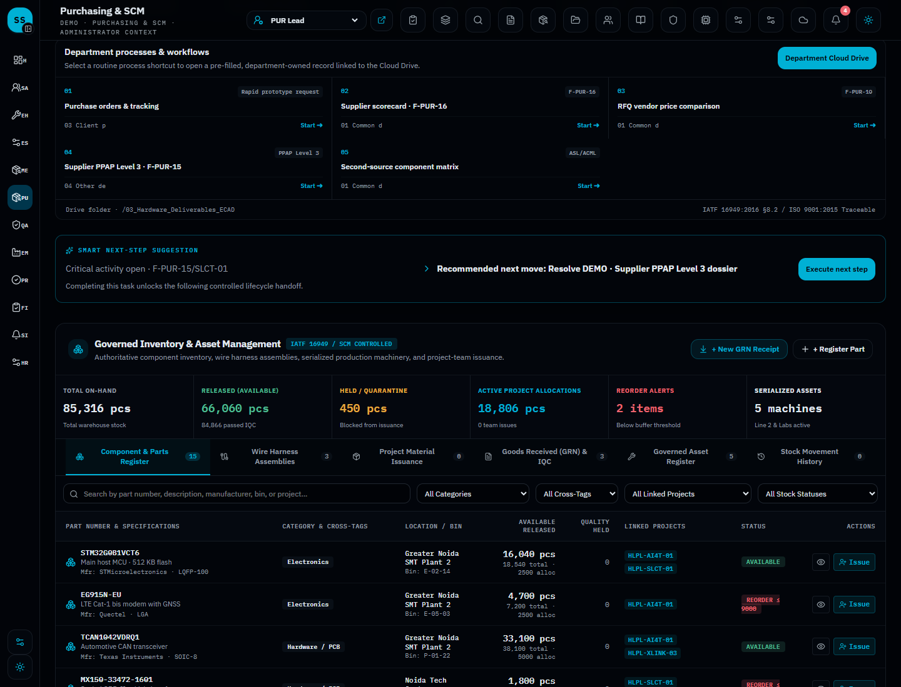

#### Step 2: Controlled Part Registration
Clicking `[+ Register Part]` opens the IATF 16949 component entry modal. Engineers provide Part Number, Description, Manufacturer, Package/Footprint, Storage Location, Bin Coordinate, Reorder Buffer, and Unit of Measure.

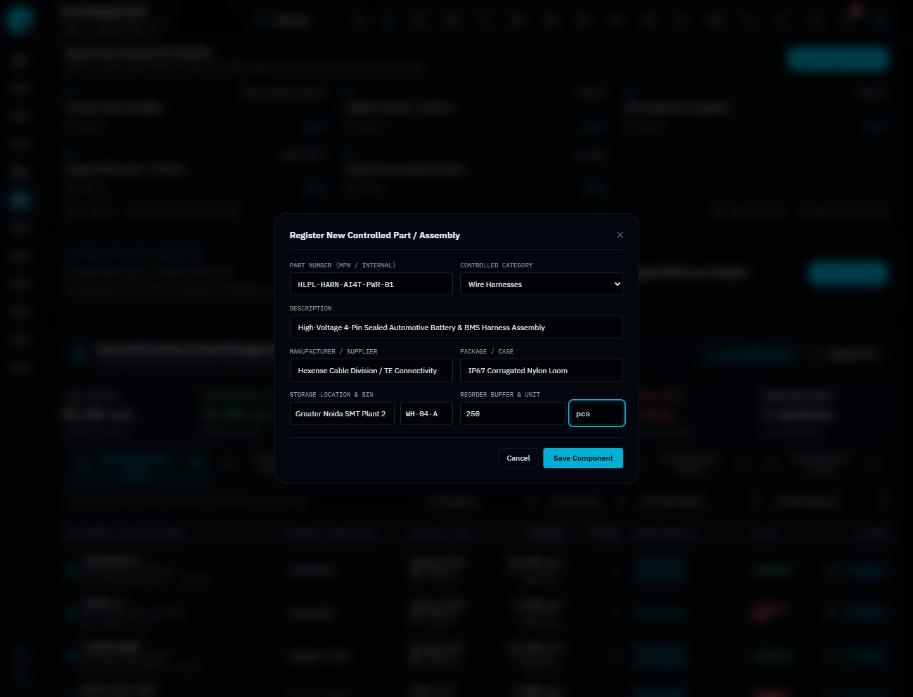

#### Step 3: Verified Component Ingestion
Once saved, the part immediately appears in the authoritative register with assigned categories, locations, and real-time stock status.

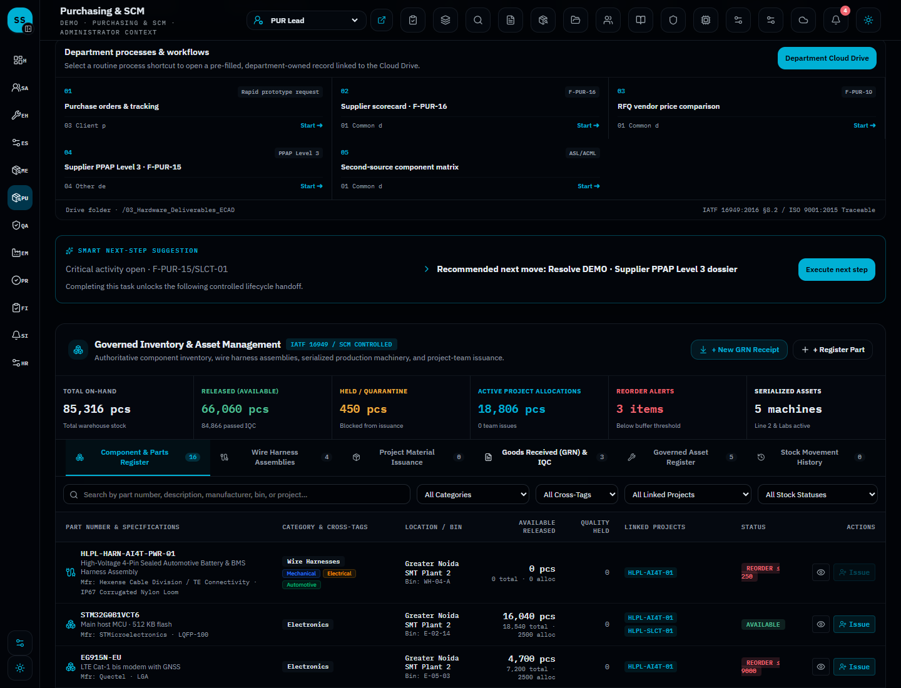

#### Step 4: Project-Team Material Issuance
Clicking `[Issue Material]` opens the server-scoped allocation modal. The recipient dropdown filters strictly to active team members of the linked project (e.g. `Avery Vale (EHW · Hardware Lead)` for project `HLPL-AI4T-01`). Zero-stock parts automatically disable issuance.

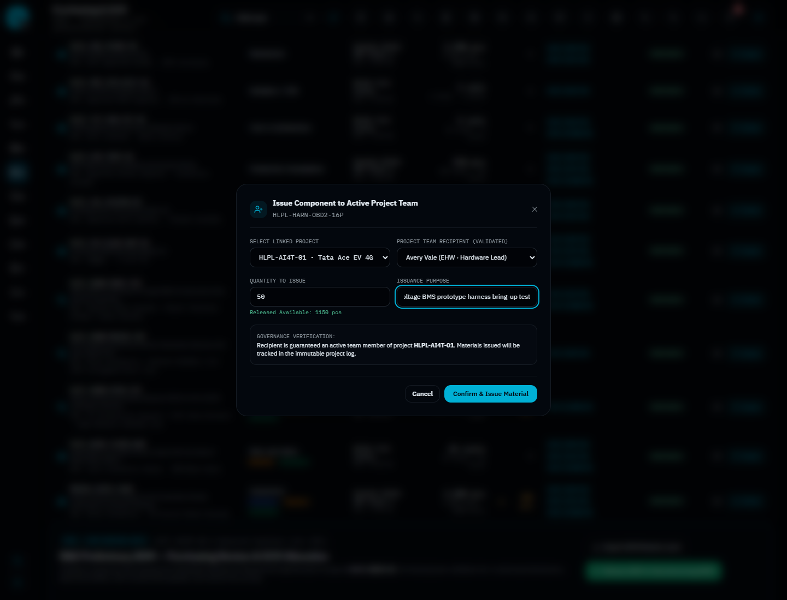

#### Step 5: Active Project Allocation Tracking (Tab 3)
Active allocations display the recipient, department, linked project, issued quantity, timestamp, issuer, and return action buttons (supporting partial or full returns).

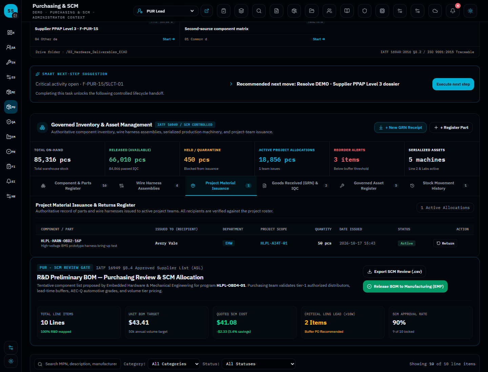

#### Step 6: Immutable Movement History & Audit Log (Tab 6)
Every stock delta creates an unalterable audit log entry containing the exact timestamp, actor, reason, lot number, quantity delta, and request key.

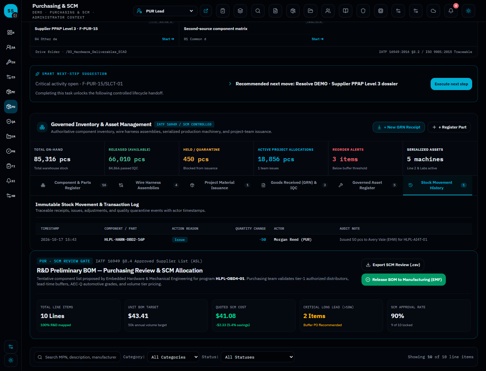

---

## Module 2: Mouser Electronics Component Intelligence & Auto-Fill

### 2.1 Overview & Capabilities
The Mouser Intelligence Module ([`src/lib/mouser-service.ts`](file:///c:/Users/Test/Documents/antigravity/SSM1/src/lib/mouser-service.ts)) provides instant automotive component enrichment:
- **1-Click Lookup**: Entering an MPN (e.g., `STM32G0B1VCT6`, `EG915N-EU`, `TCAN1042VDRQ1`, `LMR14050SDDAR`, `SM5S24A-E3/2D`, `MX150-33472-1601`) fetches verified manufacturer parameters.
- **Automotive Qualification**: Recognizes AEC-Q100 (ICs), AEC-Q200 (Passives), and AIS-140 compliance.
- **Dual-Currency Commercials**: Tentative unit costs in both USD ($) and Indian Rupees (₹), complete with volume price tiers (1, 100, 1k, 10k).
- **Direct External Links**:
  - Direct catalog buy link (`https://www.mouser.in/c/?q=[MPN]`) opening in a new tab (`target="_blank"`).
  - Official manufacturer datasheet PDF URL opening in a new tab (`target="_blank"`).
- **Automatic Controlled Taxonomy**: Maps parts into the 9 controlled IATF categories (`Electronics`, `Connectors`, `Wire and Cable`, `Wire Harnesses`, `Mechanical Parts`, `Enclosures`, `Firmware Tools`, `Production Tools`, `Packaging & Consumables`) and specific subcategories (`Microcontrollers & MCUs`, `Power Management`, `Sensors`, etc.).

### 2.2 Verified Screenshot Evidence

#### Mouser Search & Auto-Fill in Part Registration Dialog
Typing `STM32G0B1VCT6` and clicking `[ ⚡ Fetch from Mouser ]` populates all technical and commercial fields, displays a verified green banner, and attaches the datasheet.

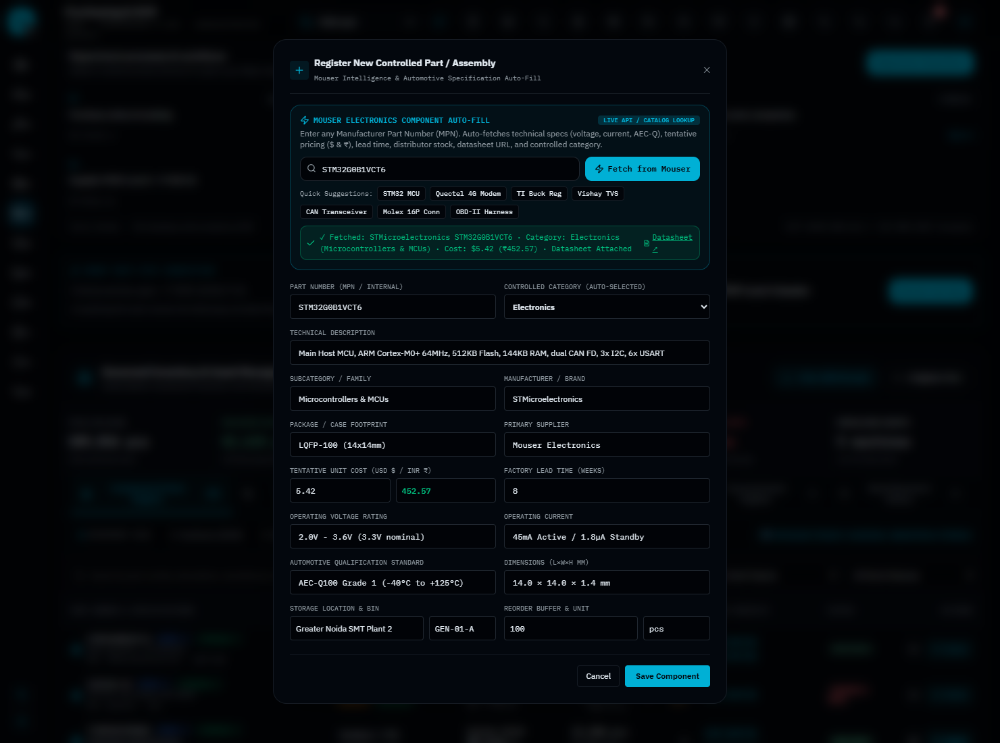

---

## Module 3: Department-Adaptive Multi-Column Inventory Presets

### 3.1 Overview & Column Layouts
To eliminate data overload while giving each department the exact parameters they require, the inventory workspace incorporates a **Department View Switcher** toolbar:

| Preset | Target Department | Primary Visible Columns | Core Focus |
| :--- | :--- | :--- | :--- |
| **`EHW`** | Embedded Hardware | Voltage Rating, Operating Current, Automotive AEC-Q Standard, Package/Footprint, Datasheet PDF ↗ | Electrical limits, pinouts, compliance |
| **`PUR`** | Purchasing & SCM | Tentative Unit Cost ($ / ₹), Volume Tier Price Breaks, Lead Time, Mouser Stock, 50k Volume Coverage % | Cost, lead time, stock vs sales targets |
| **`MECH`** | Mechanical Engineering | Dimensions (L×W×H mm), Weight/Mass (g), Ingress Protection (`IP67`), Wire Gauge, Mating Force, Machinery | Physical envelope, tooling, harness gauges |
| **`Universal`** | Executive / All | Standard Locations, Bins, Released Qty, IQC Held Qty, Reorder Point, Review Status | Global inventory & warehouse tracking |

### 3.2 Verified Screenshot Evidence

#### 1. Purchasing Department Preset (`PUR`)
Shows unit costs in USD & INR, volume tier pricing, factory lead times, Mouser distributor stock, and coverage percentage against the 50,000-unit annual sales target.

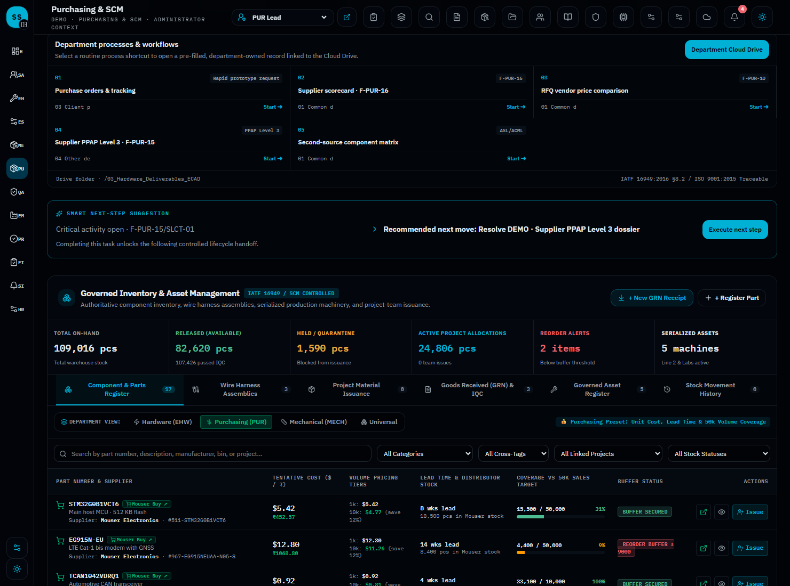

#### 2. Hardware Engineering Preset (`EHW`)
Shows operating voltage limits, operating currents, AEC-Q100 Grade 1 qualification, package footprints, and direct datasheet links.

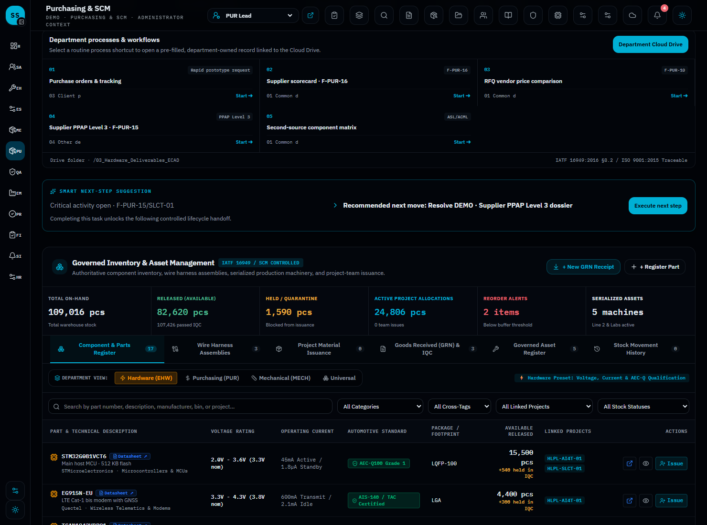

#### 3. Mechanical Engineering Preset (`MECH`)
Shows physical dimensions (L×W×H), mass/weight in grams, IP67 ratings, wire gauges (`FLRY-B 0.50mm²`), mating retention force, and compatible SMT/assembly machinery.

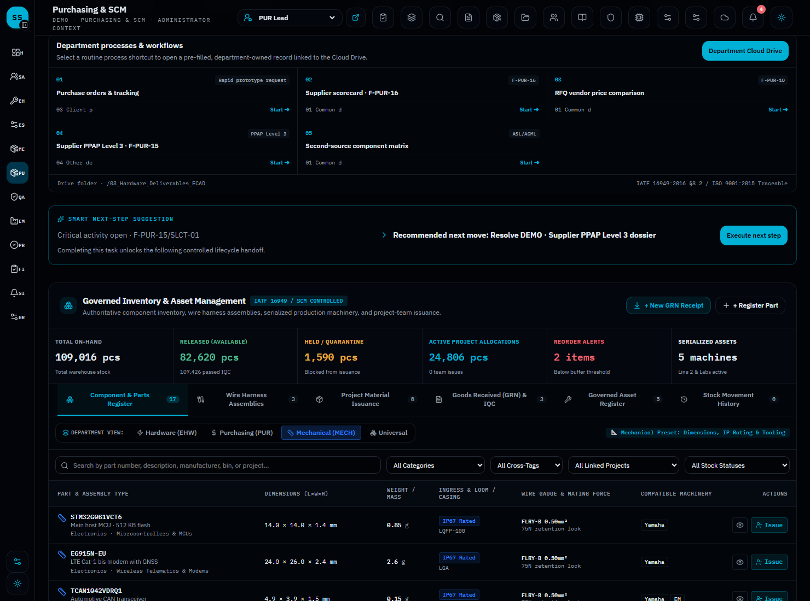

#### 4. Multi-Section Deep Part Inspection Modal (5 Tabs)
Clicking any component row opens a deep inspection modal with 5 specialized tabs:
1. **Overview & Stock**: Warehouse on-hand, released, IQC held, allocated, facility, and bin.
2. **EHW Technical**: Operating voltage, active/standby current, clock speed, operating temp, AEC-Q qualification, RoHS.
3. **PUR Commercial**: Mouser stock, factory lead time, volume price breaks, 50k sales requirement coverage.
4. **MECH Physical**: Package dimensions, mass, IP rating, wire gauge, mating force, compatible machines.
5. **Traceability**: Approved dual-source alternates, active project-team allocations, and lot tracking.

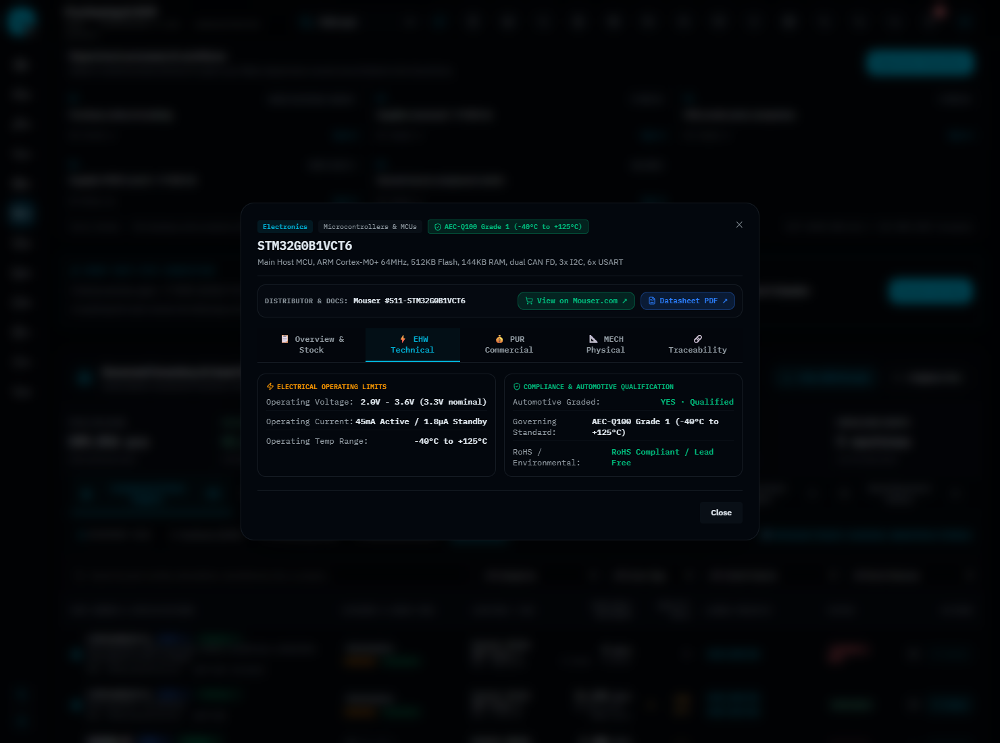

#### 5. Embedded Hardware Department Hub Integration
Navigating to `http://localhost:8080/?role=ehw` opens the Hardware department view with `LiveInventoryWorkspace` pre-configured to the Hardware preset.

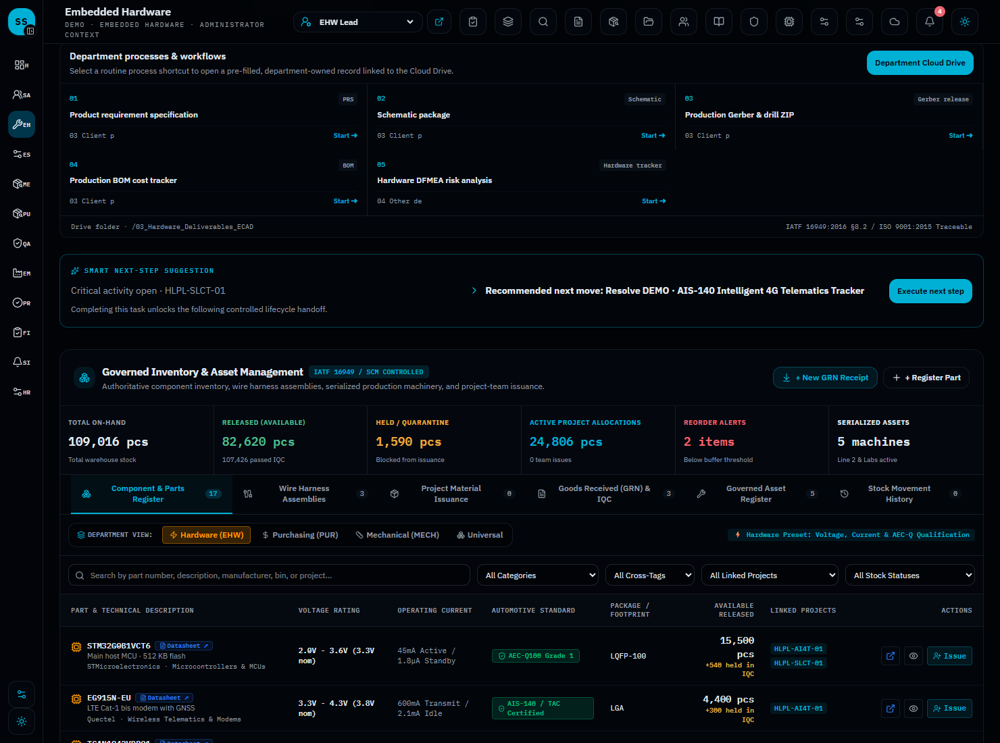

#### 6. Mechanical Department Hub Integration
Navigating to `http://localhost:8080/?role=mech` opens the Mechanical department view with `LiveInventoryWorkspace` pre-configured to the Mechanical preset.

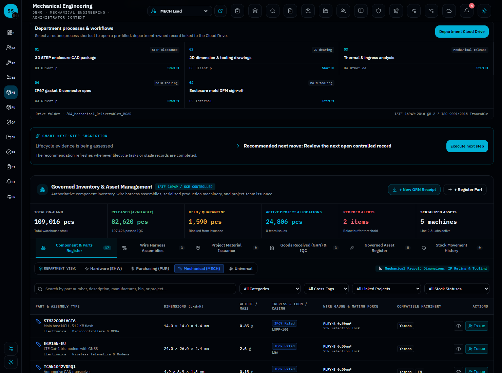

---

## Module 4: Purchasing SCM R&D BOM Review & Sourcing Optimization

### 4.1 Overview & Capabilities
The `PurchasingBOMReviewTable` ([`src/components/PurchasingBOMReviewTable.tsx`](file:///c:/Users/Test/Documents/antigravity/SSM1/src/components/PurchasingBOMReviewTable.tsx)) bridges R&D engineering BOMs and procurement execution:
- Evaluates 10 critical automotive components for `HLPL-OBD4-01` / `HLPL-AI4T-01`.
- Compares R&D target costs against quoted supplier prices (e.g. +$2.12 / 4.8% unit savings).
- Flags long lead-time components (e.g., Quectel 4G modem at 14 weeks) and recommends dual-source alternates.
- Native `[Export SCM BOM (.csv)]` and `[Release to Manufacturing]` actions.

### 4.2 Verified Screenshot Evidence

---

## Module 5: Quality Assurance DVP&R Pre-Compliance Certification

### 5.1 Overview & Capabilities
The `QualityAssuranceDVPReviewTable` ([`src/components/QualityAssuranceDVPReviewTable.tsx`](file:///c:/Users/Test/Documents/antigravity/SSM1/src/components/QualityAssuranceDVPReviewTable.tsx)) operationalizes IATF 16949 §8.3.4 design verification:
- Tracks 10 mandatory automotive electrical and environmental tests:
  - ISO 7637-2 Transients (Pulse 1, 2a, 3a/b)
  - ISO 16750-2 Load Dump 5b (40V clamp)
  - CISPR 25 Class 3 Conducted & Radiated Emissions
  - ISO 10605 ESD (±8kV contact, ±15kV air)
  - ISO 16750-4 Thermal Shock (-40°C to +85°C, 250 cycles)
  - ISO 20653 IP67 Ingress Protection
  - AIS-140 Annexure 8 Random Vibration (10Hz–500Hz)
  - AIS-140 Annexure 3 Emergency Tracking & Protocol
  - High-Temperature Operating Life (HTOL 500 hours)
- Distinguishes **Internal Lab (Hexense In-House)** from **Outsourced Accredited Lab (ARAI Pune / ICAT Manesar)**.
- Enforces zero-deviation sign-off before manufacturing gates can be unlocked.

### 5.2 Verified Screenshot Evidence

---

## Module 6: Automated Stage Gate & Manufacturing Interlock Engine

### 6.1 Overview & Dependency Enforcement
The client and internal portals feature hard dependency interlocks:
- **Prerequisite Gate**: Stage 5 (SMT Pilot Build) and Stage 7 (Production Release & PPAP Level 3) are **strictly locked** until Stage 4 Hardware Schematics (`EHW-SCH-01`) is marked `Approved`.
- Prevents premature capital expenditure and tooling fabrication before electrical verification.

### 6.2 Verified Screenshot Evidence

---

## Module 7: Executive Command Center, RACI Governance & Document Printing

### 7.1 Overview & Standards
- **Clean & Uncluttered Hub**: Free of fictional/demo labels; uses real automotive OEM master records (Tata Motors, Ashok Leyland, Select Motors).
- **Instant Role Switcher**: Quick toggle between Executive Admin, 11 Department Leads, and Client Portal.
- **RACI Responsibility Matrix**: Visualizes Responsible, Accountable, Consulted, and Informed departments across all 9 stages with automated handoff notifications.
- **Print-Ready Document Engine**: Renders clean A4 sheets without dark mode artifacts, with configurable corporate headers, accreditations, and confidentiality footers.

### 7.2 Verified Screenshot Evidence

#### Executive Command Center (Uncluttered Hub)

#### RACI Responsibility Matrix & Inter-Department Notifications
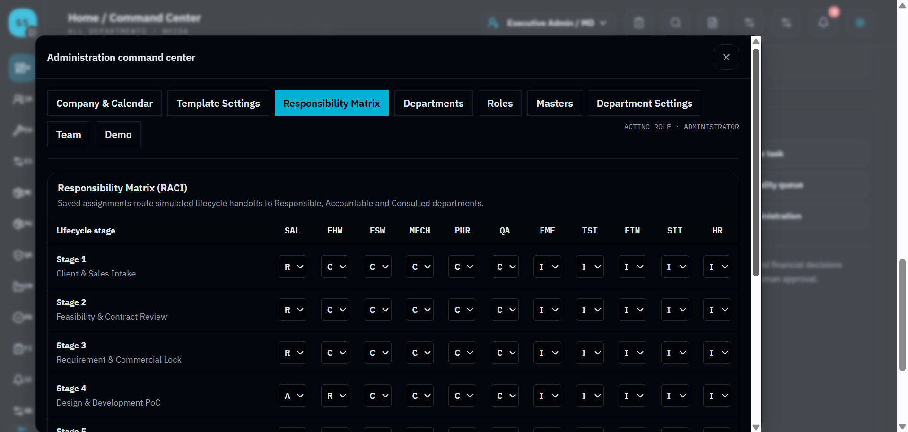

#### Full Multi-Section Document Preview & Print Sheet
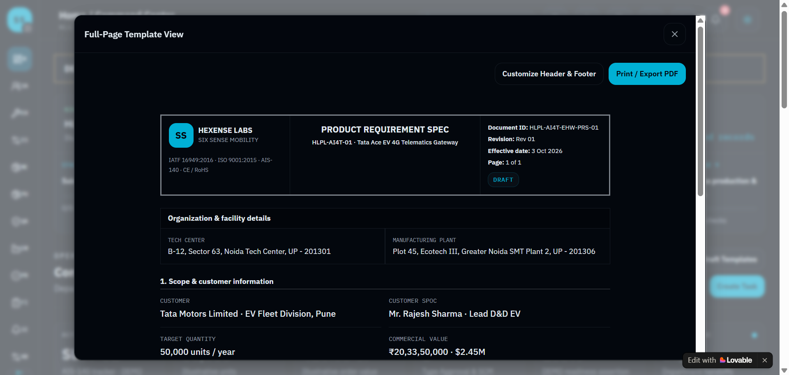

---

## Module 8: Dual-Track Persistence & Lovable Supabase Cloud Sync

### 8.1 Overview & Cloud Architecture
- **Dual-Track Persistence**: High-speed, offline-resilient IndexedDB browser-local store paired with Lovable Cloud Supabase PostgreSQL (`rzskhndweihuczbdhoxk.supabase.co`).
- **Telemetry & Health Diagnostics**: Real-time latency pinging, offline JSON snapshot exports, and cloud synchronization controls in the Administration command center.

### 8.2 Verified Screenshot Evidence

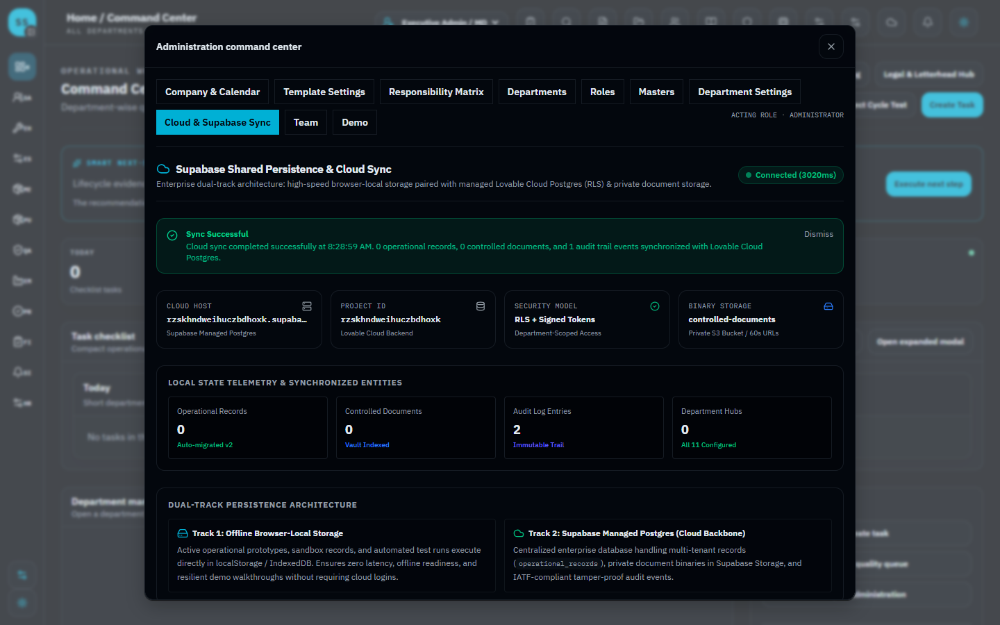

---

## Module 9: Purchasing Command Center & Department-Specific Sidebar Navigation

### 9.1 Overview & Architectural Integration
The Purchasing & Supply Chain Management (`PUR`) Command Center unifies commercial quotations, purchase orders, governed inventory stores, and supplier governance into a deeply interconnected digital workflow:

- **Department-Specific Sidebar Navigation**: When the sidebar is expanded (`w-64`), the `PUR` navigation rail renders four dedicated 1-click department sub-options:
  1. `Recordage`: Stores & Governed Inventory (Mouser lookup, Inward GRN, lot tracking, stock movements).
  2. `Quotations`: Commercial vendor quotations, volume price breaks (1k, 10k, 50k), lead times, and 1-click `[Convert to PO]`.
  3. `Purchase Orders`: Official PO register, 50,000 annual sales target coverage progress bar, batch delivery schedules, unit costs, inherited warranty terms, and 1-click `[📦 Receive GRN]`.
  4. `Suppliers (ASL)`: Approved Vendor List, supplier warranty terms, accreditation validity (IATF 16949 / ISO 9001 expiry dates, VDA 6.3 scores), verified documentation badges (PPAP L3, NDA, GST, RoHS/REACH), and comprehensive Supplier Dossier modals.
- **Mutual Cross-Linkage**:
  - Quotations seamlessly convert into active Purchase Orders, auto-locking MPN, price tier, and warranty terms.
  - POs inherit supplier warranty and accreditation validity from the ASL.
  - Issued POs feature 1-click `[Receive GRN]` which routes directly to Recordage & Stores for incoming receipt and IQC inspection.
  - Supplier cards link to their active POs and Quotations, with interactive Dossier modals for audit inspection.
- **Mouser Search API v1 Key Configuration**: Full support for entering and persistently storing a Mouser Search API key (`localStorage["scms_mouser_api_key"]` or `VITE_MOUSER_API_KEY`). When configured, live component specs, real-time pricing, stock levels, and datasheets are queried over the REST API, falling back gracefully to the offline verified automotive catalog.

### 9.2 Verified Screenshot Evidence

#### 1. Department-Specific Sidebar Navigation (PUR Expanded Rail)
The sidebar provides indented 1-click access to the 4 core purchasing modules directly under the `PUR` department button.

#### 2. Commercial Quotations & Volume Pricing Breaks (1k / 10k / 50k Tiers)
Tracks commercial vendor quotations with tiered volume pricing breaks, quoted factory lead times, warranty standards, and 1-click PO conversion. Also embeds the R&D SCM BOM Review table.

#### 3. Purchase Orders (POs) Register & 50,000 Sales Volume Alignment
Monitors total committed PO spend, quantity coverage vs. the 50,000 annual sales target for project `HLPL-AI4T-01`, batch delivery schedules, inherited supplier warranty, and 1-click `[Receive GRN]`.
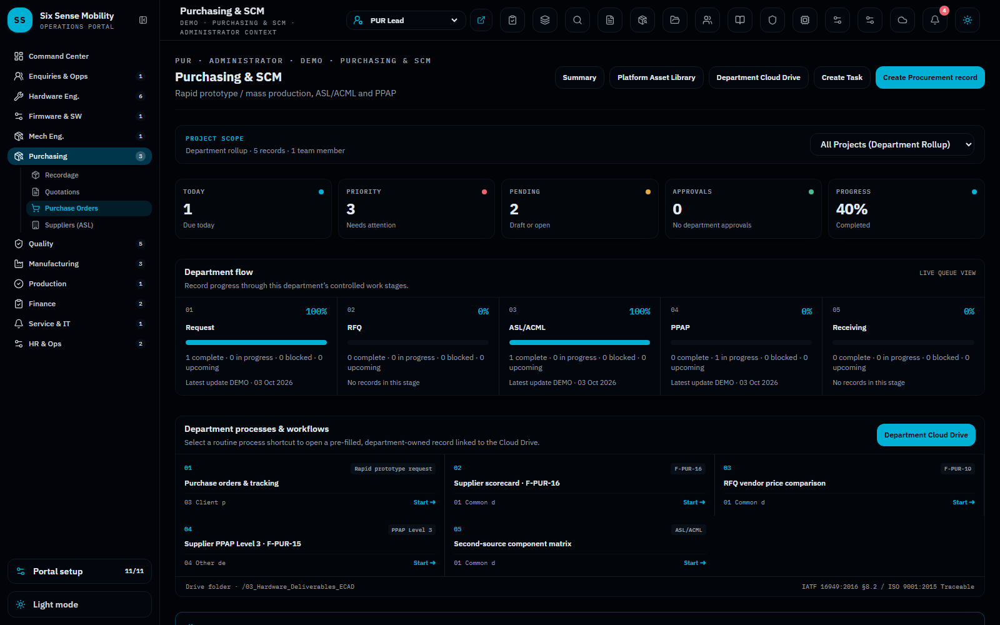

#### 4. Approved Supplier List (ASL) & Vendor Governance
Displays Tier-1 automotive suppliers (Mouser, Arrow, Quectel, TI, Molex) with warranty coverage, accreditation validity expiry dates, VDA 6.3 audit scores, verified documentation badges, and `+ Raise PO` action.

#### 5. Comprehensive Supplier Dossier Modal
Displays full vendor dossier: contact details, official automotive warranty terms (coverage, RMA TAT SLA), accreditation validity schedule (IATF 16949 & ISO 9001 expiry dates, VDA 6.3 score, next audit date), and compliance documentation (PPAP Level 3, Bilateral NDA, GST, RoHS/REACH).
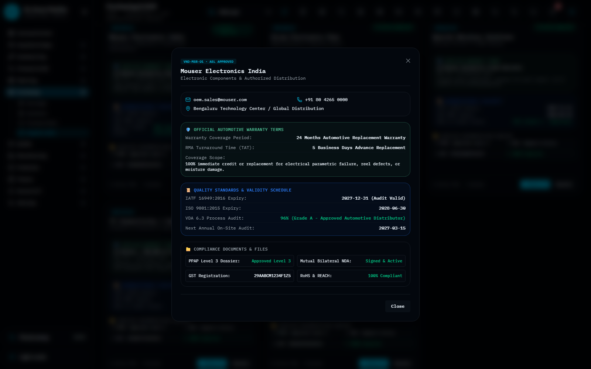

#### 6. Mouser Search API Key Configuration Modal
Allows purchasing and hardware engineers to configure their official Mouser Search API key for real-time live component and pricing lookups, with seamless fallback to the verified automotive catalog.
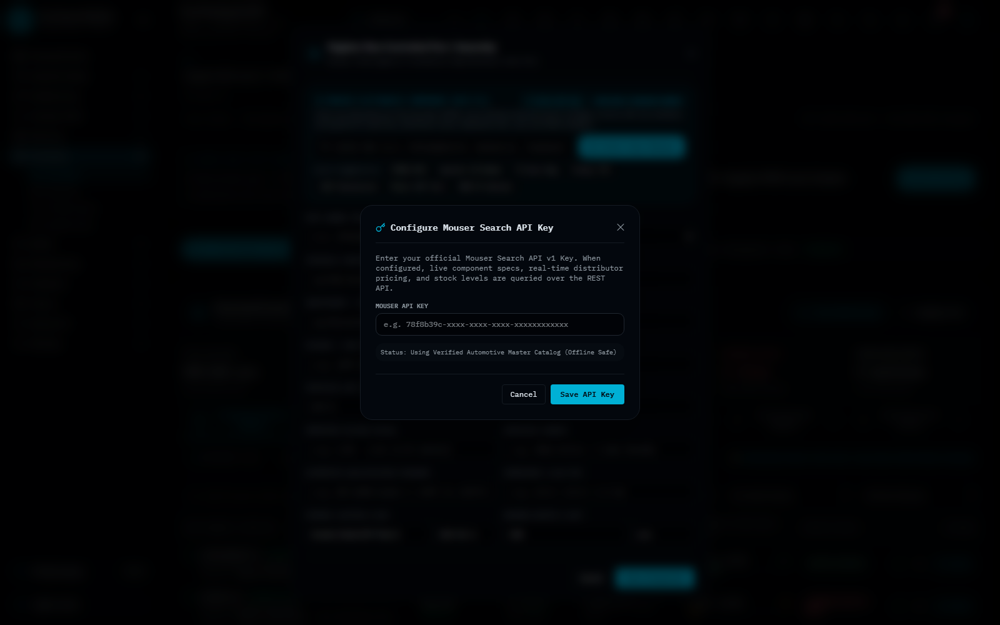

## Module 10: Role-Aware Sidebar Navigation with Favorites & Dynamic Accordion Work Groups

### 10.1 Architectural Overview & Core Capabilities
The Hexense Labs SCMS sidebar navigation adapts intelligently to the signed-in persona (`admin`, department leads, `client`):
- **Favorites System at Top**:
  - Always appears first with pinned items.
  - Hovering any item in any work group reveals a pin/unpin star trigger (`★`).
  - Pinned items persist across browser sessions in `localStorage` under `scms_user_favorites_${persona.id}`.
  - Sensible role-focused defaults:
    - **Executive Admin**: Overview, Projects, Work queue, Inventory, Procurement, Quality, Documents, People.
    - **Department Leads**: My work, Department queue, Active projects, Department primary workspace (e.g. for PUR: Recordage, Quotations, Orders, Suppliers).
- **Expandable Accordion Work Groups with Dynamic Arrow Rules**:
  - **Administrator View**:
    - Favorites is open at the top.
    - **`Overview`** section is **expanded by default** (with arrow pointing down `ChevronDown`).
    - **All remaining work groups** (`Commercial & Projects`, `Engineering & Delivery`, `Inventory & Procurement`, `Quality & Compliance`, `Documents & Collaboration`, `People & Organization`, `Administration`) start **unexpanded (collapsed)** by default with arrow pointing right (`ChevronRight`).
    - Clicking any group header toggles expansion, and navigating to any page automatically auto-expands its containing group.
  - **Department Lead View**:
    - "For others all expanded": All department work groups (`My work`, `Projects`, `Department workspace`, `Reference`) start **expanded by default** with downward chevrons, giving immediate visibility into all permitted department tasks, workflows, and documents.
- **Dual Display Modes**:
  - **Expanded View (`w-64`)**: Full company branding (`SS` monogram badge + Six Sense Mobility / Hexense Labs title), group headers, badges, open task counters, pin stars, and bottom setup wizard status.
  - **Compact Rail View (`w-16`)**: Icon-only navigation with tooltips on hover, active indicator badges, and one-click expand toggle (supporting `[` keyboard shortcut).
  - **Accessible Mobile Drawer**: Complete responsive drawer matching the exact desktop role-aware group structure.

### 10.2 Verified Screenshot Evidence

#### 1. Administrator Role-Aware Sidebar View
Overview section is expanded with arrow down; remaining work groups (Commercial, Engineering, Inventory, Quality, Documents, People, Administration) start cleanly collapsed with rightward arrows.
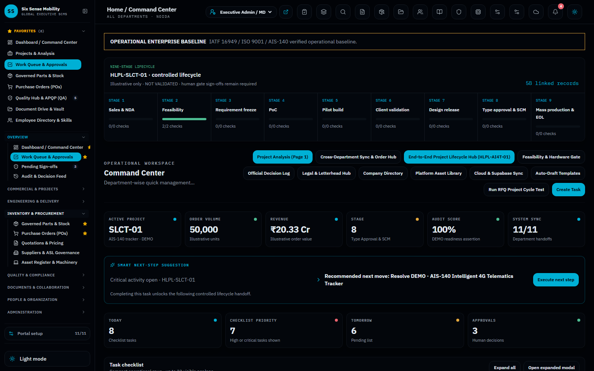

#### 2. Department Lead Role-Aware Sidebar View
All department groups (My work, Projects, Department workspace, Reference) start expanded by default with quick access to all department-specific options.
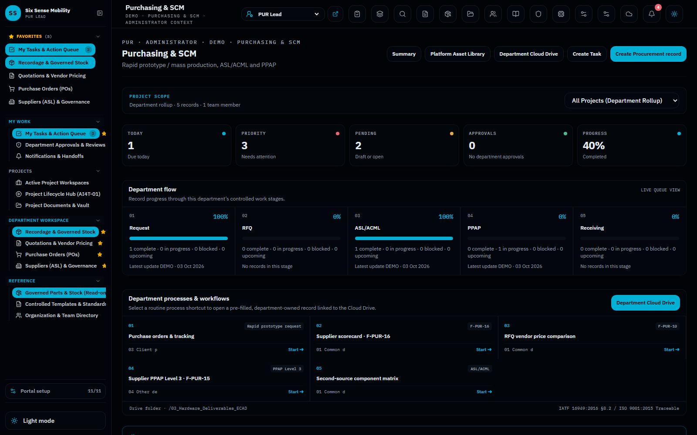

#### 3. Compact Rail Sidebar View
Icon-only compact navigation with SS badge, tooltips, and fast collapse/expand toggle.
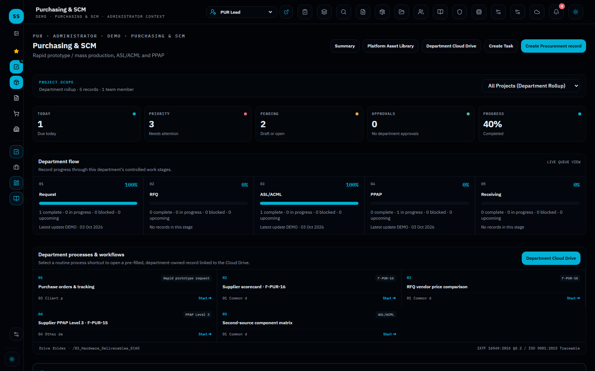

---

## Module 11: Dual-Lifecycle Smart BOM Architecture & 'What-If' Stock Simulation

### 11.1 Architecture & Separation
The Smart BOM workspace ([`DualLifecycleSmartBOMWorkspace.tsx`](file:///c:/Users/Test/Documents/antigravity/SSM1/src/components/DualLifecycleSmartBOMWorkspace.tsx)) explicitly decouples exploratory engineering drafts from governed production releases:
- **Tentative Engineering Draft (`v0.3-tentative`)**: Permits provisional candidate MPNs, unverified components, generic placeholders, and dynamic "What-If" stock simulations.
- **Governed Released Baseline (`Rev A ECO-2026-004`)**: Immutable baseline locked to PPAP Level 3 documentation, AIS-140 TAC type approval, and production kitting. Changes require an authorized Engineering Change Order (ECO number and rationale).
- **Dynamic "What-If" Simulation**: Recalculates real-time shortages across active released stores for variable planned build quantities (e.g. 5,000 units: 5/7 shortage lines, deficit of $59,150.00).
- **Revision Diff Engine**: Side-by-side comparison across revisions (Base `Rev A` vs Target `v0.3-tentative`: +1 added, -1 removed, -$0.020 net unit cost delta).
- **Unified CSV Exports**: Indented Hierarchical BOM, Flattened Production BOM with comma-separated reference designators, and Shortage Requisition Report.

### 11.2 Verified Screenshot Evidence
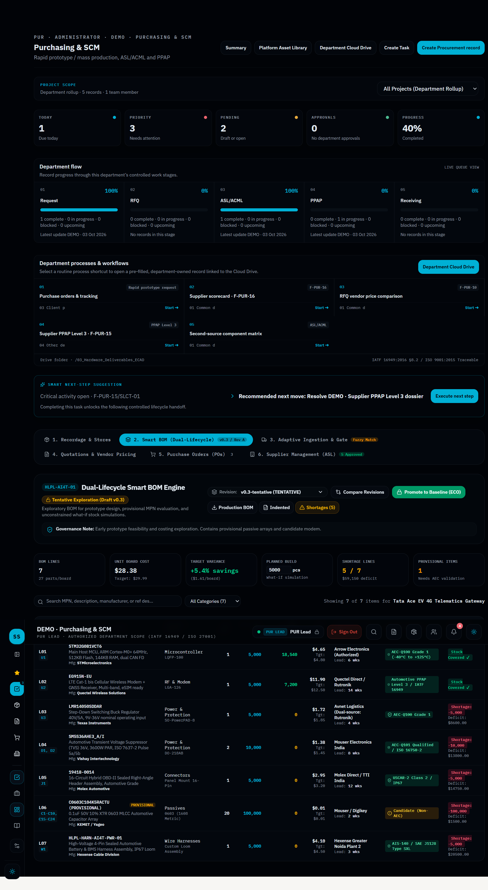

---

## Module 12: Adaptive Purchase Order & Invoice Ingestion Engine

### 12.1 Multi-Format Ingestion
The ingestion engine ([`AdaptiveIngestionAndStagingGate.tsx`](file:///c:/Users/Test/Documents/antigravity/SSM1/src/components/AdaptiveIngestionAndStagingGate.tsx)) handles arbitrary supplier spreadsheets from Digi-Key, Mouser, Arrow, and local fabricators:
- **Multi-Alias Dictionary Fuzzy Matcher**: Maps 16 standard fields with live matching confidence rating (120% High Confidence match) and dropdown column overrides.
- **Distributor Presets**: Mouser Electronics Packing List, Digi-Key Billed Invoice, Precision Wiring Delivery Challan, and Arrow Electronics Commercial Billing.

---

## Module 13: Governed Pre-Inventory Staging Gate & Zero Automatic Stock Posting

### 13.1 Pre-Inventory Staging Gate & 3-Way Reconciliation
All imported rows pass through a pre-inventory review gate prior to creating purchasing drafts or inward records:
- **Vendor Reconciliation**: Matches against Approved Supplier List (`procurement.vendors`).
- **Component Catalog Reconciliation**: Normalizes MPNs (stripping packaging suffixes `-ND`, `-REEL`, `/TR`) into `Exact Catalog Match`, `Approved Substitute Match`, or `Unmatched Candidate`.
- **PO Variance Detection**: Identifies billed vs. ordered quantity deviations and unauthorized unit price hikes.

### 13.2 The Zero-Automatic-Stock-Posting Invariant
Under no circumstances does an imported invoice or delivery challan increment active inventory balance.
Generating an inward delivery creates a pending **Inwarding (GRN) Draft** on **100% IQC Quarantine Hold** (`quantityAccepted: 0`, `quantityHeld: 100%`, bin `IQC-HOLD-STAGE-01`).
Active stock is only incremented when the Quality team executes an signed **IQC Disposition Release** (`QA-IR-2026-088`).

### 13.3 Verified Screenshot Evidence
#### Staging Table Review
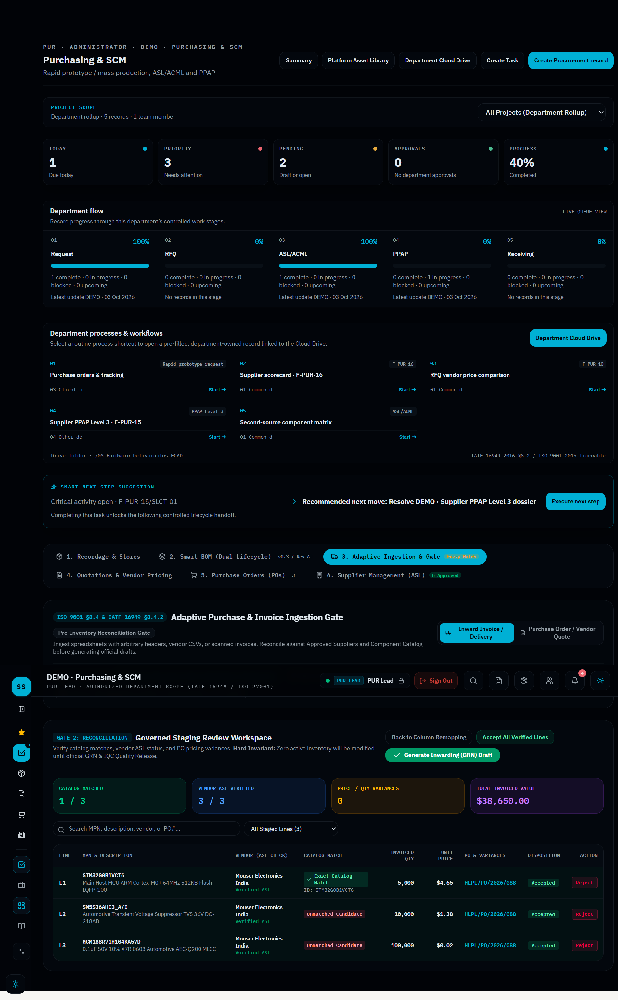

#### Zero Automatic Stock Posting & IQC Quarantine Hold
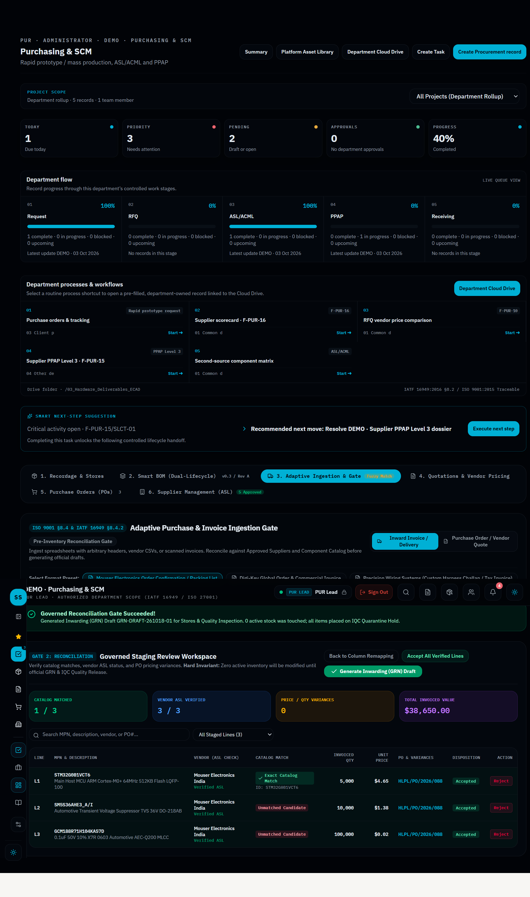

---

## Module 14: Complete Plant Machinery & Asset Lifecycle Management

### 14.1 Asset Fleet & Machine Compatibility Mapping
The asset management surface ([`LiveInventoryWorkspace.tsx`](file:///c:/Users/Test/Documents/antigravity/SSM1/src/components/LiveInventoryWorkspace.tsx)) tracks production machinery, service test equipment, IMTE calibration instruments, and facility tooling:
- **Machine-to-Component Compatibility**: Maps machines directly to compatible parts via `compatiblePartNumbers` (Yamaha SMT Mounter linked to MCUs/passives; Schleuniger CrimpCenter linked to battery harnesses; Chroma EOL Jig linked to main PCB).
- **Bulk CSV Ingestion**: Imports asset registers with serial number and tag deduplication.
- **Audit Schedule Exports**: 1-click downloads for `Asset Register Export (.csv)` and `Calibration & Maintenance Due Schedule (.csv)` (filtered to instruments due within 60 days).

---

## Module 15: Department Lead Authentication & Strict Role Confinement

### 15.1 Real Authentication Gateway & Confinement
- **IATF 16949 / ISO 27001 Security Gateway**: Accessible via `[🔑 Lead Auth]` in the header with credentials directory and eye toggle password visibility.
- **Strict Role Confinement**: When signed in as a Department Lead (e.g. Morgan Reed · Purchasing Lead), the user is confined strictly to their department workspace. The Persona Switcher dropdown is locked/hidden, preventing lateral access or administrative escalation.
- **Session Termination**: `[Sign Out of Current Session]` terminates the session and safely returns the user to the default gateway.

---

## Module 16: Department Lead Coordination Center, Team & Task Management, and Full-Page Approvals

### 16.1 Overview & Architecture
To eliminate cluttered tables and fragmented modals, the portal integrates the **Department Lead Coordination Center** ([`DepartmentLeadCoordinationCenter.tsx`](file:///c:/Users/Test/Documents/antigravity/SSM1/src/components/DepartmentLeadCoordinationCenter.tsx)) into all 11 department hubs, accompanied by a dedicated, full-page approvals surface:

- **1-Click Instant Assignee Switcher**: Every task card in Kanban and row in Table view features an inline assignee dropdown. Department Leads can instantly reallocate tasks across their team in zero clicks/dialogs.
- **Teams Tasks Hub**: Switchable between an interactive Kanban board and dense tabular view, complete with real-time project scoping, priority filtering, and status progression.
- **Department Projects Hub**: Tracks deliverables, APQP lifecycle stages, target delivery dates, and progress percentages (e.g. `HLPL-AI4T-01` Tata Ace EV 4G at 92%) with 1-click drill-downs into project-specific tasks.
- **Department Teams & Capacity Matrix**: Visualizes active workloads (e.g. `1 Tasks · 25% Capacity`), competency tiers (`Level 2` to `Level 4 - Advanced Specialist`), and core technical skill tags.
- **Full-Page Approvals View ([`ApprovalsFullPageView.tsx`](file:///c:/Users/Test/Documents/antigravity/SSM1/src/components/ApprovalsFullPageView.tsx))**: Replaces pop-up dialogs with a full-viewport governance center displaying digital signer authority, risk-classified decision cards (`CRITICAL`, `HIGH`, `MEDIUM`), IATF 16949 §8.3.4 regulatory clauses, and 1-click human sign-offs (`[Approve Gate]`, `[Return for Rework]`, `[Reject]`).
- **Sidebar Notification Cleanup**: Notification links have been removed from the sidebar. The interactive notification bell on the top header serves as the sole, non-cluttered alert center.

### 16.2 Verified Visual Evidence

#### Full-Page Approvals View (No Pop-up Modals)
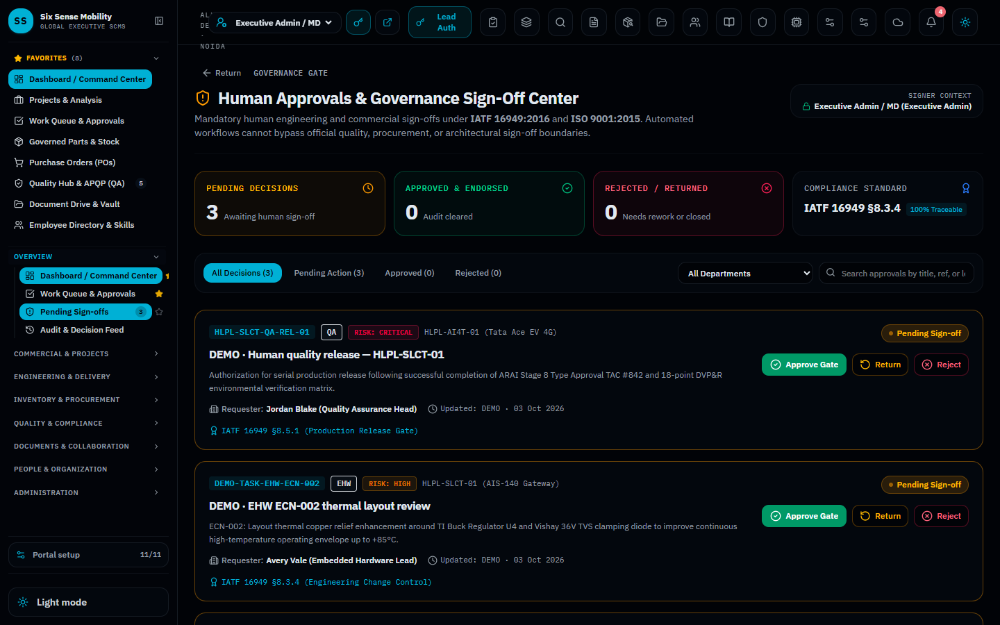

#### Teams Tasks Hub (Kanban View with 1-Click Assignee Reallocation)
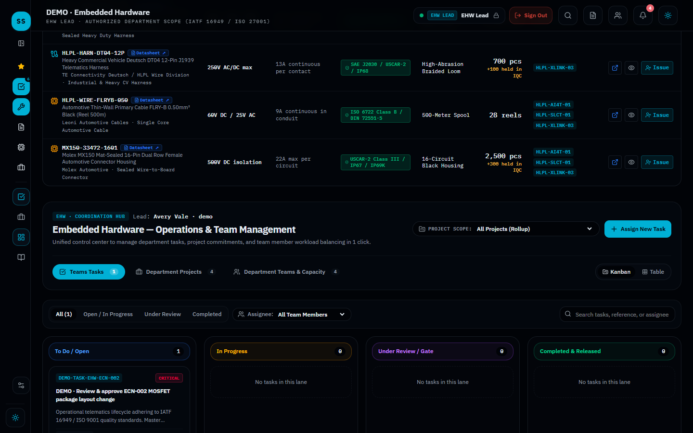

#### Department Projects View (Milestone Deliverables & Progress)
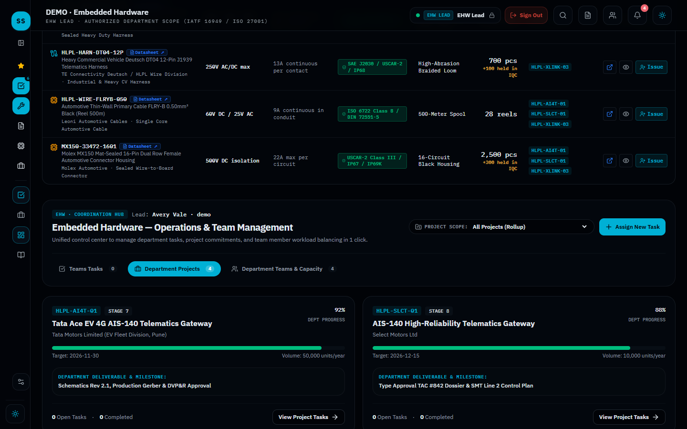

#### Department Teams & Capacity Roster (Workload Balancing & Skills)
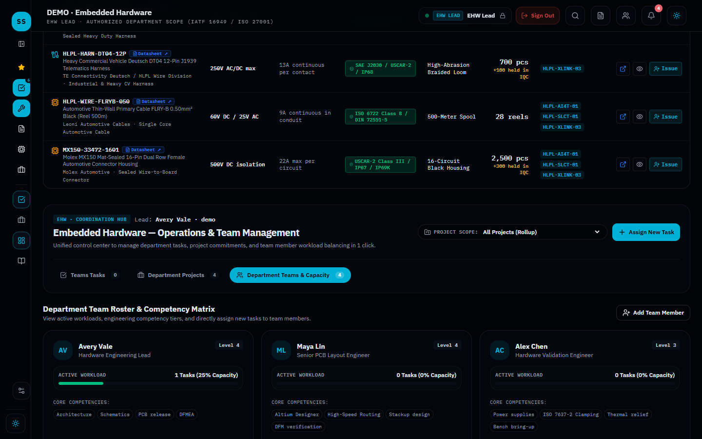

#### Purchasing Coordination Hub
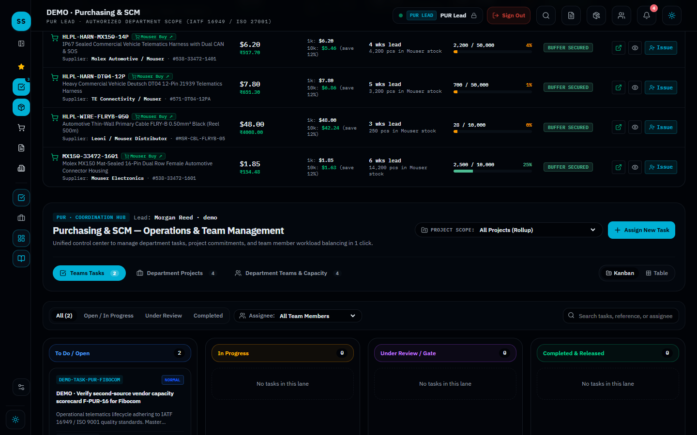

---

## Module 17: Living Update Protocol for Engineering Agents

When adding, modifying, or refactoring portal features:
1. **Pre-Check**: Read this Knowledge Base and [`SSM_ONE_WEB_PORTAL_MASTER_PLAN.md`](file:///c:/Users/Test/Documents/antigravity/SSM1/SSM_ONE_WEB_PORTAL_MASTER_PLAN.md) to understand existing data models and UI patterns.
2. **Execute Changes**: Apply TypeScript-strict modifications (`exactOptionalPropertyTypes: true`).
3. **Verify Locally**:
   - `npx tsc --noEmit` (ensure 0 type errors).
   - `npm run build` (ensure clean production bundle).
4. **Capture Visual Evidence**: Use the browser controller / Playwright script to capture screenshots into `docs/images/` and the conversation brain directory.
5. **Update Knowledge Base & Master Plan**:
   - Add new feature descriptions, parameters, and screenshots to this Knowledge Base.
   - Update [`SSM_ONE_WEB_PORTAL_MASTER_PLAN.md`](file:///c:/Users/Test/Documents/antigravity/SSM1/SSM_ONE_WEB_PORTAL_MASTER_PLAN.md) completed milestones and relevant sections.
6. **Git Sync**: Commit and push to `origin/main` without rewriting history to maintain Lovable synchronization.

