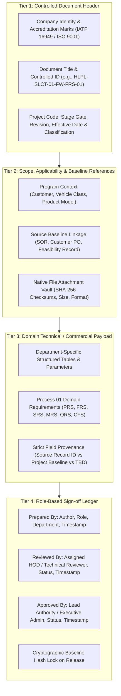

# Implementation Plan: Document Standardization, Controlled Auto-Drafting Engine & Stage Gate Freezes

## Goal Description
Implement **Batch 2 of the SSM One Portal Refinement**, expanding the document engine from 12 prototype templates to a robust, standardized **4-Tier Controlled Document Architecture** covering the 38 document families defined in [`docs/SSM One Document Catalogue - Auto-Drafting Audit and Native Upload Rules.json`](../../docs/SSM%20One%20Document%20Catalogue%20-%20Auto-Drafting%20Audit%20and%20Native%20Upload%20Rules.json) and [`docs/DOCUMENT_STANDARDIZATION_PLAN.md`](../../docs/DOCUMENT_STANDARDIZATION_PLAN.md).

This equips every department (`SAL`, `EHW`, `FW`, `SW`, `MECH`, `PUR`, `QA`, `EMF`, `MMF`, `FIN`, `SIT`, `HR`) with real, domain-specific requirements sheets (Process 01 across all departments), eliminates shared generic telematics boilerplate, embeds native file attachment cards (with SHA-256 checksums and file sizes), and enforces the Stage 2/3 multi-department requirement freeze gates.

---

## User Review Required

> [!IMPORTANT]
> **No Fake Signatures & No Invented Technical Values**:
> Following the project master plan and document-control requirements, missing document values will explicitly render as `TBD — owner confirmation required` with provenance markers, rather than auto-populating synthetic specifications. Approval signatures strictly display the authenticated signer's name, role, and timestamp, with unsigned states showing `Pending Review/Sign-off`.

> [!NOTE]
> **Native File Uploads vs In-Browser Simulation**:
> CAD/EDA packages (`.step`, `.pcbdoc`, Gerber), MCU firmware binaries (`.bin`, `.hex`), and statutory test lab certificates (ARAI/ICAT/NABL PDFs) are treated as **controlled native file attachments** with cryptographic SHA-256 hashes and PDF cover sheets, adhering to our earlier architectural boundary (no heavy in-browser 3D CAD rendering or bare-metal JTAG flashing).

---

## Proposed Architecture: 4-Tier Standardized Document Layout

Every generated and viewed document in the portal will adhere to the rigorous automotive 4-tier standard:



---

## Proposed Changes

### Component 1: Document Draft Engine (`src/lib/document-draft.ts`)

#### [MODIFY] [`src/lib/document-draft.ts`](../../src/lib/document-draft.ts)
- **Expand `DOCUMENT_FORMATS`** from 12 prototype schemas to full domain-specific coverage aligned with the 38 document families:
  - `SAL-ENQ` / `ENQ`: Customer Enquiry Register
  - `SAL-SOR` / `SOR`: Statement of Requirements
  - `NDA` / `MNDA`: Mutual Non-Disclosure Agreement
  - `QUO`: Commercial Quotation & Costing
  - `REVIEW`: Contract & Multi-Department Feasibility Review (`HLPL/F/MKT/01`)
  - `EHW-PRS`: Hardware Product Requirements Specification
  - `FW-FRS`: Embedded Firmware Requirements Specification (HAL, CAN J1939, Dual-Bank FOTA)
  - `SW-SRS`: Cloud & Application Software Requirements (AIS-140, MQTT, Ingestion APIs, BLE)
  - `MECH-MRS`: Mechanical & Enclosure Requirements (IP67/IP69K, Dimensions, Gasket, Thermal)
  - `PUR-SRS`: Sourcing & Component Feasibility Matrix (Long lead parts, ASL, MOQ)
  - `QA-QRS`: Quality Assurance & DVP&R Requirements (PPM targets, AIS-004/AIS-140 compliance)
  - `EMF-MPR`: Electronics Manufacturing Process Requirements (accepted outsourced PCBA receipt/traceability, box-build, controlled programming and functional checks)
  - `MMF-MPR`: Mechanical Manufacturing Process Requirements (Tooling tolerances, Anodizing, Fit checks)
  - `FIN-CFS`: Financial Feasibility & Cost Target Sheet (BOM cost, labor, margin, payback)
  - `BOM`: Controlled Engineering Bill of Materials
  - `DFMEA`: Design Failure Mode & Effects Analysis
  - `PFMEA`: Process Failure Mode & Effects Analysis
  - `CP`: Process Control Plan
  - `DVP` / `DVP&R`: Design Verification Plan & Report
  - `PDI`: Pre-Dispatch Inspection Report (actual results and QA disposition; no generated external certificate)
  - `PPAP`: Submission dossier/index; `PSW`: separate Part Submission Warrant subtype
  - `8D`: Eight-discipline corrective-action report; `NCR`: separate nonconformance record
  - `ECR`: Change request; `ECO`: separately controlled change order
  - `INV`: Commercial Invoice
  - `SKILL`: Competency Assessment & Skill Matrix
- **Enhance `buildDocumentDraft`**:
  - Distinguish between **Internal Engineering Documents** and **Client-Facing Deliverables**.
  - Attach native file metadata schema (`attachments: Array<{ filename, format, sizeBytes, sha256, uploadedAt }>`).
  - Calculate field completion percentages and explicit missing field counts.

---

### Component 2: Standardized Document Viewer & Native Attachment Card

#### [NEW] [`src/components/DocumentStandardViewer.tsx`](../../src/components/DocumentStandardViewer.tsx)
- Modularized full document viewer and printable document engine:
  - **Tier 1 (Header)**: Standardized company banner, accreditation logos, document ID, project, revision, security classification pill.
  - **Tier 2 (Scope & Baseline)**: Baseline linkage, customer requirements reference, and native attachment cards.
  - **Tier 3 (Payload)**: Renders domain-specific sections with provenance tags (`[Project Baseline]`, `[Source Record]`, `[TBD]`).
  - **Tier 4 (Sign-off Ledger)**: Structured sign-off blocks with status pills (`Approved`, `Pending`, `Rework Required`), dates, and role verification.
  - **Export Capabilities**: Clean printable A4 layout (`@media print`), Markdown export, and source JSON snapshot download.

#### [NEW] [`src/components/NativeAttachmentCard.tsx`](../../src/components/NativeAttachmentCard.tsx)
- Interactive card for native CAD (`.step`, `.dwg`), PCB (`.pcbdoc`, Gerber `.zip`), firmware (`.hex`, `.bin`), and lab certificates (`.pdf`):
  - Displays file icon, filename, file size, SHA-256 hash badge with one-click copy, and download action.

---

### Component 3: Integration with Admin & Project Workspaces (`src/routes/index.tsx`)

#### [MODIFY] [`src/routes/index.tsx`](../../src/routes/index.tsx)
- Update `PrintableDocumentModal` to utilize `DocumentStandardViewer`.
- Upgrade the 12 `autoDraftTemplates` in `src/routes/index.tsx` to reference the expanded document formats and Process 01 domain requirement sheets.
- Wire the **Stage 2 Multi-Department Feasibility Freeze** and **Stage 3 Requirements Freeze**:
  - If a project is transitioning from Stage 02 to 03, check that participating leads have signed the Contract Review Record (`HLPL/F/MKT/01`).
  - If transitioning from Stage 03 to 04, verify that the Multi-Department Requirements Package (`PRS`, `FRS`, `SRS`, `MRS`) is approved before allowing stage completion.

---

### Component 4: Regression & Verification Test Suite

#### [MODIFY] [`tests/document-draft.test.cjs`](../../tests/document-draft.test.cjs)
- Add comprehensive test cases verifying:
  1. Explicit registered types and approved aliases resolve correctly; ambiguous titles/IDs and unknown types remain unsupported.
  2. The 12 domain requirements specifications (Process 01: `EHW-PRS`, `FW-FRS`, `SW-SRS`, `MECH-MRS`, `PUR-SRS`, `QA-QRS`, `EMF-MPR`, `MMF-MPR`, `FIN-CFS`, etc.) contain proper domain-specific fields without hardware boilerplate leakage.
  3. Strict provenance: fields unpopulated in source records return `TBD — owner confirmation required` and do not invent arbitrary values.
  4. Native file attachment metadata includes valid SHA-256 hashes and format identification.
  5. 4-tier layout integrity across both printable rendering and exported JSON snapshots.

---

## Verification Plan

### Automated Tests
Run the current test files via Node test runner; passing checks provide evidence for their covered cases, not a guarantee of zero regressions:
```powershell
& "C:\Program Files\nodejs\node.exe" --test tests/department-chronicles.test.cjs tests/department-scope.test.cjs tests/document-draft.test.cjs tests/migration-preservation.test.cjs tests/portal-store.test.cjs tests/responsibility-version.test.cjs tests/test-auth-persona.test.cjs
```
*Target*: All discovered tests pass with zero failures. Record the actual count and source revision; do not use a historical count as a completion criterion.

### Typecheck & Production Build
```powershell
& "C:\Program Files\nodejs\node.exe" node_modules\typescript\bin\tsc --noEmit
& "C:\Program Files\nodejs\node.exe" node_modules\vite\bin\vite.js build
```
*Target*: 0 TypeScript errors and clean Nitro SSR production build.

### Manual Verification
1. Navigate to [http://localhost:8080/](http://localhost:8080/).
2. Open any department workspace (e.g. Firmware `?role=fw` or Software `?role=sw`).
3. Open a document (e.g. `FW-FRS-01` or `SW-SRS-01`).
4. Click **Open Full Document Viewer / Print**:
   - Verify the **Tier 1 Header** (Controlled ID, classification, revision).
   - Verify the **Tier 2 Scope** (SOR reference, baseline linkage).
   - Verify the **Tier 3 Domain Payload** (e.g. HAL, CAN J1939, and FOTA parameters for Firmware; AIS-140 Annexure 8 and MQTT for Software; no generic boilerplate).
   - Verify the **Tier 4 Sign-off Ledger** (Prepared By, Reviewed By, Approved By with explicit status).
5. Verify Print preview (`Ctrl+P`) renders clean A4 pages without table clipping.

## Reviewed Antigravity execution contract — 19 October 2026

This section qualifies the earlier proposal where it is incomplete or inconsistent. Status: READY FOR INCREMENTAL IMPLEMENTATION, not implemented or production accepted. Review baseline: local web checkout after pulling `7d8243c` (Completed auth and members). Inspect current HEAD and working changes before editing; another actor may have advanced the branch.

### Scope and existing foundations

- Work in this separate web repository: `C:/Users/Test/Documents/GitHub/SSM-new-web`. Do not edit Android or the planning-library repository as an incidental part of this batch.
- Read AGENTS.md, docs/SSM_ONE_MASTER_PLAN.md, SSM_ONE_WEB_PORTAL_MASTER_PLAN.md, docs/DOCUMENT_STANDARDIZATION_PLAN.md and the catalogue JSON before implementation. The master plan outranks this proposal. The four sections above are a proposed UI layout, not an assertion that a standard mandates this exact architecture or that the company is certified.
- Reuse the existing document template version/registry, explicit-type handling, missing-field reporting, saved draftSnapshot, provenance JSON export, responsibility-version history, private document functions and browser-local attachment storage. Extend and extract them; do not rebuild or discard them.
- TEST authentication source code now exists, but source/commit titles do not prove account provisioning, successful localhost/Lovable login or document-signing authority. Preserve it. Missing live identities block authenticated acceptance only, not local template implementation. Do not substitute URL roles or demo personas for verified signer authority.
- Keep the existing Lovable backend. Do not switch environments, provision more accounts, change authentication, apply live migrations or publish production as an incidental document change. Prepare necessary server contracts/migrations for separate review and record exactly what remains undeployed. No inventory/finance mutations from document generation.

### Corrections required before claiming coverage

1. Produce a machine-readable coverage matrix keyed by all 38 catalogue family IDs, with document subtypes, explicit template IDs/versions, owning department, applicability, source fields, output formats, review route, native evidence requirements, implementation status and tests. Reconcile 89 unique source blocks and 90 family-source links. D02 and D04 remain clarification-only. Families are not a requirement to create 38 separate templates/files, and the current short format list does not establish full coverage.
2. Include applicable Process 01 sheets for SAL, EHW, FW, SW, MECH, PUR, QA, EMF, MMF, FIN, SIT and HR/OPS. SIT infrastructure/service feasibility and HR/OPS capacity/competency feasibility are missing from the earlier list. Protect confidential HR fields. Derive applicability from the project's pinned responsibility configuration; do not require every department for every project.
3. Do not hard-code FreeRTOS, CAN, MQTT, AIS-140, IP ratings, target costs, test results or compliance editions as actual project values. They may be schema prompts or explicitly illustrative fixtures only. Real values require selected-project evidence. Missing/conflicting values must be reported explicitly.
4. Treat PFMEA/DFMEA, PPAP/PSW, NCR/8D and ECR/ECO as separate controlled subtypes when their content, lifecycle or authority differs. Do not use slash notation as an automatic type alias. Preserve legacy document IDs/revisions. Agree new abbreviations with the registry rather than inventing official numbering.
5. EMF covers accepted outsourced PCBAs, traceability, box-build, programming and functional checks. In-house SMT/reflow/SPI/AOI is out of scope. QA owns independent criteria/disposition; MMF owns mechanical production. Retired TST records remain historical until explicitly mapped.
6. Company identity, accreditation marks, signatures and dates come from verified settings/evidence. No unsupported certification or electronic-signature compliance claim. Distinguish a recorded approval from a legally qualified digital signature; a SHA-256 hash alone proves neither authorship nor approval.

### Incremental delivery order

**A — Inventory and registry.** Deliver the coverage matrix and a versioned registry. Resolve templates by explicit type or approved unambiguous aliases. Preserve current unsupported-type behavior. Implement project/source selection, conflict reporting and immutable source snapshots before widening the template list.

**B — First complete document flow.** Start with SOR, feasibility review, EHW PRS and BOM. Use two different projects and one sparse project. All entry points (Auto Draft, Inspect, workspace documents, Drive, lifecycle dossier and client view) must resolve the exact project/document/revision and the same saved snapshot. Preserve user-entered draft text; a viewer extraction must not silently ignore or replace edited content. Then expand through the coverage matrix in small passing batches.

**C — Viewer, attachments and exports.** Extract the viewer without changing ownership or existing attachment identity. For each attachment record document ID/revision, organization/department scope, uploader, server timestamp, storage status, checksum algorithm and byte length. Compute SHA-256 from actual file bytes and verify it against downloaded bytes where possible; a 64-character string alone is not verification. Preserve authentic native lab/CAD/firmware files. Do not embed large binaries in localStorage. Reuse private signed links and handle expired/denied links explicitly. Preserve existing local/IndexedDB files through migration and refresh.

Markdown/JSON/PDF alone do not close the approved export requirement. Provide document-appropriate editable DOCX/XLSX outputs where required by the catalogue, or mark the affected type incomplete with its dependency. Narrative and wide-matrix renderers may differ, while metadata and snapshot content remain consistent. External certificates remain native attachments, not generated credentials.

**D — Gate and revision contracts.** Local/demo stage controls may show simulated validation, clearly labelled. Operational Stage 2/3 freeze enforcement requires verified server transactions, active signer capabilities, applicable department sheets, all required decisions and explicit N/A rationale. Recheck evidence revision/status inside the transaction; protect against stale sessions, duplicate requests and concurrent decisions. Freeze a source snapshot/template version/evidence manifest and audit record. An edited source creates an impact/review requirement or a new revision; it must not rewrite a released baseline. Keep immutable version history and project-pinned responsibility versions. Missing backend support leaves operational progression unavailable, not client-side approved.

**E — Regression and handoff.** Record source revision, changed files, new tests, actual results, screenshots/exports, limitations and next batch. Update the feature knowledge base and sync ledger. No force-push or published-history rewrite. Coordinate Git/Lovable changes and inspect newer commits before syncing. Never overwrite unrelated local work or bulk-add audit images/scripts/native files.

### Required acceptance evidence

- All catalogue families have an explicit coverage disposition; clarification-only and unsupported entries are visible. No headline claim of complete coverage based on template count.
- Same type on two projects cannot mix source values or files. Sparse/conflicting sources remain missing/conflicted. Template version and document revision are independent.
- Wrong-department, employee-versus-lead, client/internal, stale signer, revoked membership, direct-file access and rejected/unfinished gate tests fail closed in the authenticated environment. Folder placement/assignment is not an access grant.
- Changing a source after draft save does not silently alter the saved snapshot. Released revisions retain evidence, approval attribution and original attachment checksums after refresh.
- Preview, editable export and PDF agree. Render and visually inspect narrative, landscape matrix and multipage examples, including repeated headers, page numbers, units, long text, clipping and signature sections. Test workbook formulas independently. DOM presence alone does not prove print/export layout.
- Verify both localhost and Lovable preview separately. A demo URL role check is not an authenticated login or server authorization test. Browser-local records remain explicitly local until the complete workflow persistence contract is implemented.

### Portable verification commands

Use the installed project runtime rather than assuming a Program Files path. Discover the current test files so the auth tests are not missed by a stale npm script:

```powershell
$documentTestFiles = @(Get-ChildItem -LiteralPath tests -Filter '*.test.cjs' | ForEach-Object { $_.FullName })
node --test $documentTestFiles
npx tsc --noEmit
npm run build
```

These checks must pass after each meaningful implementation group. Add behavior-focused tests for new contracts and preservation risks. Do not accumulate feature changes while compilation or regression checks fail.

### Copyable Antigravity instruction

Implement this reviewed plan in batches A–E, starting with the catalogue coverage matrix and the existing document engine. Preserve current auth work, local data, source snapshots, historical IDs and published Git history. Use the existing Lovable backend; no automatic backend switch, production publish, live migration or user provisioning. Finish and validate each batch before continuing. Report implemented versus deferred scope with exact evidence; do not equate generated templates, a hash or passing local tests with operational approval/compliance.