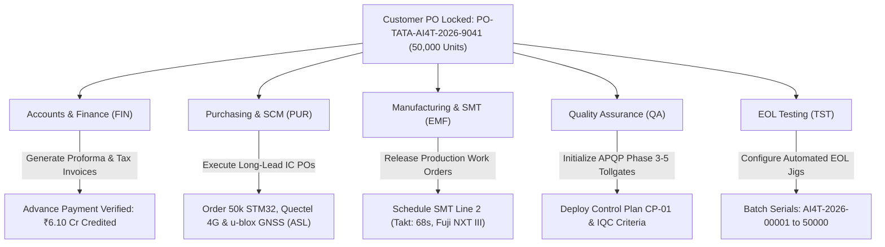

+----------------------------------------------------------------------------------------------------+
| HEXENSE LABS PRIVATE LIMITED                              Department: Sales & Order Management     |
| DOCUMENT CONTROL HEADER                                   Standard: IATF 16949 Cl 8.2 / ERP Core   |
+----------------------------------------------------------------------------------------------------+
| Document Title : Customer Purchase Order (PO) & Order Intake Synchronization                       |
| Document ID    : HLPL-AI4T-SAL-PO-01                      Order Date  : 28-May-2026                |
| Project Code   : HLPL-AI4T-01 (Intelligent 4G Telematics) Revision    : 01                         |
| Customer Name  : Tata Motors Limited (EV Commercial Fleet)PO Number   : PO-TATA-AI4T-2026-9041     |
| Order Quantity : 50,000 Units (Annual Delivery Contract)  Total Value : ₹20,33,50,000.00           |
| Order Status   : Verified, Locked & Synchronized to ERP   Finance Ref : FIN-REC-2026-042           |
+----------------------------------------------------------------------------------------------------+

## 1. Customer Commercial Order Summary
Tata Motors Limited has formally executed Purchase Order **`PO-TATA-AI4T-2026-9041`** based on approved quotation `HLPL-AI4T-SAL-QUO-01` and frozen specification `HLPL-AI4T-EHW-PRS-01`:
- **Product Description**: AIS-140 Intelligent 4G Telematics Gateway (HLPL-AI4T-01).
- **Total Contract Quantity**: **50,000 units** scheduled across four quarterly production tranches.
- **Contract Unit Price**: ₹4,067.00 ($41.20) Ex-Works Noida, exclusive of 18% IGST.
- **Total Purchase Order Value**: **₹20,33,50,000.00** (USD \$2.45 Million).
- **Advance Payment Received**: 30% advance deposit (**₹6,10,05,000.00**) received and credited in HDFC Bank on 29-May-2026.

---

## 2. Automated Downstream Departmental Synchronization

---

## 3. Quarterly Delivery Tranche Schedule

| Tranche | Scheduled Delivery Month | Batch Quantity | Target Serial Range | Status |
|:---:|:---:|:---:|---|:---:|
| **Tranche 1 (Pilot Ramp)** | August 2026 | **2,500 units** | `AI4T-2026-00001` to `AI4T-2026-02500` | **In Production (SMT Line 2)** |
| **Tranche 2 (Mass Rollout)** | November 2026 | **15,000 units** | `AI4T-2026-02501` to `AI4T-2026-17500` | SCM Components Allocated |
| **Tranche 3 (Peak Fleet)** | February 2027 | **20,000 units** | `AI4T-2026-17501` to `AI4T-2026-37500` | Long-Lead Confirmed |
| **Tranche 4 (Completion)** | May 2027 | **12,500 units** | `AI4T-2026-37501` to `AI4T-2026-50000` | Forecast Locked |

---

## 4. Order Verification Sign-Off
- **Sales & BD Lead**: Riley Stone · 28-May-2026
- **Senior Financial Controller**: Priya Voss · 29-May-2026
- **VP Operations**: Vikram Deshmukh · 30-May-2026
